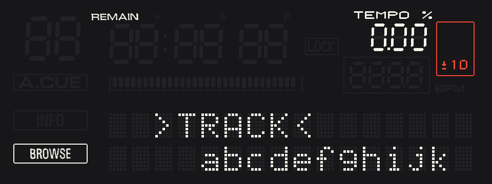
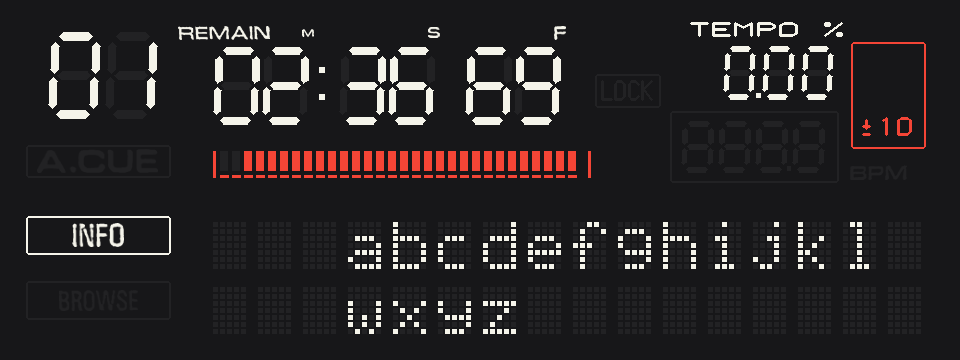
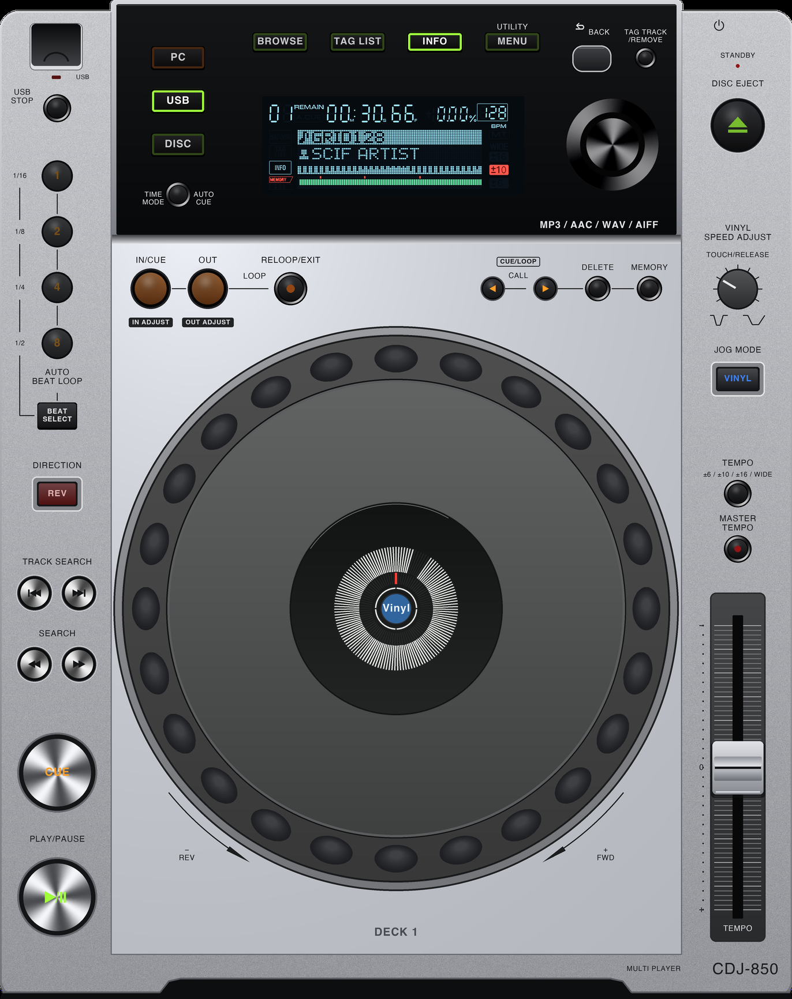
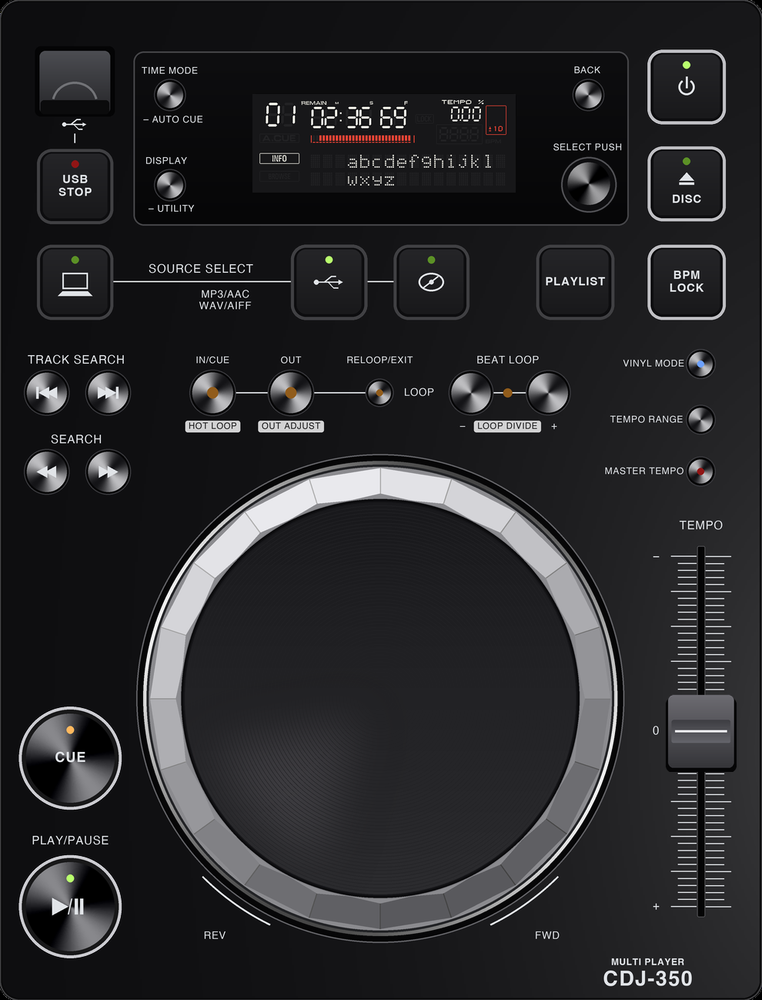

<div align="center">

# Pioneer CDJ-850 & CDJ-350 Emulator

**Original firmware. Emulated hardware.**

The Pioneer CDJ-850 and CDJ-350 running their real firmware on your computer.

[](LICENSE)
[](#quick-start)
[](https://www.qemu.org/)
[](#not-included)

[Features](#features) · [Quick start](#quick-start) · [What works](#what-works) · [Modding & testing](#modding--testing) · [Documentation](#documentation)

<table>
  <tr>
    <td align="center"><a href="docs/img/decks/cdj850-browse.png"></a><br><sub>CDJ-850: browsing a USB stick</sub></td>
    <td align="center"><a href="docs/img/decks/cdj850.png"></a><br><sub>CDJ-850: playing a track with memory cues</sub></td>
  </tr>
  <tr>
    <td align="center"><a href="docs/img/decks/cdj350-browse.png"></a><br><sub>CDJ-350: browsing a USB stick</sub></td>
    <td align="center"><a href="docs/img/decks/cdj350.png"></a><br><sub>CDJ-350: playing a track</sub></td>
  </tr>
  <tr>
    <td align="center"><a href="docs/img/decks/cdj850-face.png"></a><br><sub>CDJ-850 virtual deck</sub></td>
    <td align="center"><a href="docs/img/decks/cdj350-face.png"></a><br><sub>CDJ-350 virtual deck</sub></td>
  </tr>
</table>

<sub>Screens and virtual decks captured from the emulator. Select one for full size.</sub>

</div>

Both the **CDJ-850** and **CDJ-350** share the same MAIN board architecture, so this emulator boots either player's original firmware, mounts a virtual USB stick, and loads and plays tracks from it. Each player's own 24-bit audio DSP program runs on an emulated Freescale DSP56371 and computes the sound you hear, while the display window and virtual deck recreate each model's front panel, display, and illuminated controls.

Based on the [Pioneer CDJ & XDJ Emulator](https://github.com/Stijn-Jacobs/cdj-nxs2-qemu) project.

For an easy way to mod your firmware, see the browser firmware patchers and mod repositories:
- **CDJ-850:** [CDJ-850 Mods](https://github.com/FruityLemonade/cdj-850-mods) · [CDJ-850 Firmware Patcher](https://fruitylemonade.github.io/cdj-850-mods/)
- **CDJ-350:** [CDJ-350 Mods](https://github.com/FruityLemonade/cdj-350-mods) · [CDJ-350 Firmware Patcher](https://fruitylemonade.github.io/cdj-350-mods/)

The emulator is aimed at people developing and testing firmware mods.

<a id="features"></a>

## Features

| | |
|---|---|
| 🎛️ **The real firmware** | Both processors run the player's own code: the Renesas SH7263 (SH-2A big-endian) MAIN CPU (`IC103`) and the Freescale DSP56371 24-bit audio DSP (`IC301`) that MAIN boots over SHI. |
| 🔊 **The DSP's own sound** | The emulated DSP56371 executes the four-stage program MAIN uploads at boot and streams audio through the ESAI transmitter to your host sound card. |
| 🖥️ **Model-accurate displays** | **CDJ-850:** high-level emulation of Panel CPU `IC1007` over SCIF1 renders the 3-row dot-matrix/character display, track overview waveform, memory cue markers, BPM/tempo readout, and 135° jog display.<br>**CDJ-350:** high-level emulation of Panel CPU `IC501` over SCIF1 renders the 2-line 16-character VFD, segmented track/time/BPM/tempo readouts, 30-segment playing-address bar, and panel indicators. |
| 🌀 **Play and mix** | Transport, cueing, loops, tempo fader (`±6` / `±10` / `±16` / `WIDE`), `MASTER TEMPO`, and `VINYL` touch/scratch and pitch bend work on both players, alongside each model's own features (memory cues, auto beat loops, and `VINYL SPEED ADJUST` on the CDJ-850; `BPM LOCK` and `LOOP DIVIDE` on the CDJ-350). |
| 🔌 **USB-B PC mode** | Emulates the R8A66597 USB function controller for PC mode, sending USB-MIDI and USB-HID reports to a host or controller bridge. |
| 🧪 **Built for modding** | Patch and validate `C850MAIN.UPD` and `C350MAIN.UPD` firmware updates, inject SH-2A code hooks or DSP56371 patches, load up to 1.44 MB of custom code into free SDRAM at boot, and script panel inputs in virtual time. |

<a id="quick-start"></a>

## Quick start

**You will need** a recent multi-core CPU (see [Limits](#limits)), about 2 GB of disk for the QEMU build tree, Python 3.11 or newer, your own copy of `C850MAIN.UPD` **version 1.13** (for CDJ-850) or `C350MAIN.UPD` **version 1.14** (for CDJ-350), and a rekordbox USB export or a folder of music.

**1. Get a shell for your system** (only your own line applies):

| system | what to do first |
|---|---|
| **Windows** | Install [MSYS2](https://www.msys2.org) and open the **MSYS2 MINGW64** shell. `setup.sh` tells you which packages to add. |
| **Linux** (native or WSL) | Nothing. Any shell will do; `setup.sh` prints the `apt` command for anything missing. |
| **macOS** (Apple silicon or Intel) | Install the Xcode Command Line Tools and [Homebrew](https://brew.sh), then the build tools and a newer bash (macOS's own is 3.2; the scripts find Homebrew's by themselves): `xcode-select --install` then `brew install bash ninja meson pkgconf glib pixman python` |

**2. Clone and run setup** (for CDJ-850, CDJ-350, or both):

```sh
git clone https://github.com/FruityLemonade/cdj-850-emulator.git
cd cdj-850-emulator

# CDJ-850
./setup.sh --firmware path/to/C850MAIN.UPD

# CDJ-350
./setup.sh --model cdj350 --firmware path/to/C350MAIN.UPD
```

`setup.sh` checks your build tools, fetches and patches QEMU 11.1.2, builds `qemu-system-sh4eb` with both the `cdj850` and `cdj350` machines, unpacks the update into a 4 MB NOR flash image (`extract/cdj850/flash_cdj850.bin` or `extract/cdj350/flash_cdj350.bin`), and prepares your virtual USB stick (from a rekordbox export or a plain folder of music). Every step is safe to re-run and is skipped when already done. See [Setup in detail](docs/setup.md) for all options.

**3. Play:**

```sh
./start.sh --app                  # CDJ-850 with the full virtual deck face
./start.sh --model cdj350 --app   # CDJ-350 with the full virtual deck face
```

Or omit `--app` for the compact display window on its own (`Ctrl-C` stops everything).

- **CDJ-850:** Select **USB**, turn the browse knob to move through the list, and press it to open a folder or load a track. Click **PLAY/PAUSE** to start or pause. On the keyboard, press `U` for USB, `↑` or `↓` to browse, `Enter` to select, and `Space` to play or pause (every key: [Using the deck](docs/using-the-deck.md)).
- **CDJ-350:** Hold **USB** (~1 s, as on the real unit) until the library appears. Turn the **SELECT** knob to **TRACK**, press it to open the track list, then select and press a title to load it. Use **PLAY/PAUSE** to start or pause playback. A short press of **DISPLAY** switches between track info (`INFO`) and the browser (`BROWSE`). To set a master BPM, hold **BPM LOCK**, then turn and press **SELECT**; press **BPM LOCK** again to engage it.

To keep user UTILITY settings (such as auto cue, tempo range, and jog mode) in flash across launches, start with:

```sh
PERSIST=1 ./start.sh --app
```

**Updating:** `git pull`, then `./start.sh` as usual. When a pull changes the C sources or patches, `start.sh` notices and offers to rebuild (`./build.sh display` does the same by hand).

<a id="what-works"></a>

## What works

| | CDJ-850 | CDJ-350 |
|---|---|---|
| **Play and mix** | `PLAY/PAUSE`, `CUE`, `IN/OUT` & `AUTO BEAT LOOP` (`1`/`2`/`4`/`8`), `RELOOP/EXIT`, `DIRECTION REV`, memory cues (`MEMORY`, `DELETE`, `CALL ◀/▶`), tempo fader (`±6` / `±10` / `±16` / `WIDE`), `MASTER TEMPO`, `VINYL` touch/scratch, pitch bend, and `VINYL SPEED ADJUST` knob. | `PLAY/PAUSE`, `CUE`, `IN/CUE`, `OUT`, `RELOOP/EXIT`, `BEAT LOOP` / `LOOP DIVIDE -/+`, tempo fader (`±6` / `±10` / `±16` / `WIDE`), `MASTER TEMPO`, `BPM LOCK`, `VINYL MODE` touch/scratch, and pitch bend. *(Hardware has no memory cues or `VINYL SPEED ADJUST` knob.)* |
| **Display** | 3-row dot-matrix/character display (track, artist, browser, `INFO`/`MENU`/`TAG LIST`), elapsed/remaining time, BPM, tempo range, track overview waveform with memory cue markers, and 135° centre jog display. | 2-line 16-character VFD (`INFO`/`BROWSE`), segmented track number, elapsed/remaining time (`MM:SS.FF`), BPM, tempo %, tempo range, 30-segment playing-address bar, and `A.CUE`/`LOCK`/`REMAIN` indicators. *(Hardware has no jog display or waveform overview.)* |
| **Panel & lamps** | Source, transport, loop, `REV`, `VINYL`, and `MASTER TEMPO` lamps follow the firmware, including flashes. A button press wakes the deck from standby. | Source, transport, loop, `BEAT LOOP`, `VINYL`, and `MASTER TEMPO` lamps follow the firmware, including flashes. |
| **USB-B PC mode** | Emulated PC mode sends USB-MIDI and USB-HID reports to a host or test client. | Emulated PC mode sends USB-MIDI and USB-HID reports to a host or test client. |

<a id="modding--testing"></a>

## Modding & testing

### Browser firmware patchers

- **CDJ-850 ([repo](https://github.com/FruityLemonade/cdj-850-mods) · [patcher](https://fruitylemonade.github.io/cdj-850-mods/)):** Builds installable updates from an original `C850MAIN.UPD` (v1.13). Options include **USB WIDE tempo**, **USB FLAC playback** (stereo 16/24-bit at 44.1/48 kHz), **Hot cues** (*unfinished*), **Quantized loops** (block-precise, no drift; QUANTIZE 1, 1/2 or 1/4 beat in UTILITY), **Loop resize**, **Loop roll** (*prototype*, lands on the next quantize point with quantize on), **BPM up to 999**, **BPM decimals**, **BPM lock** (±100%), **Phase meter**, **INFO screen order** (playing BPM, Camelot key, and rekordbox rating), **Browse history & sort**, **Zoomed scrolling waveform**, and **Auto standby** (20 to 120 minutes, also on USB with a stick mounted).
- **CDJ-350 ([repo](https://github.com/FruityLemonade/cdj-350-mods) · [patcher](https://fruitylemonade.github.io/cdj-350-mods/)):** Builds installable updates from an original `C350MAIN.UPD` (v1.14). Options include **USB FLAC playback** (stereo 16/24-bit at 44.1/48 kHz; see the [FLAC documentation](mods/flac/README.md)), **Quantized loops** (QUANTIZE and DRIFT FIX in UTILITY), **INFO track details** (`Title - Artist`, actual BPM with Camelot key, and rekordbox rating), **Played markers and track sort** (BPM or key order in UTILITY > SORT), and **BPM up to 999**. See [CDJ-350 firmware notes](docs/cdj350.md) for each port.

The CDJ-850 INFO rating display, BPM lock, and Phase meter, as well as all CDJ-350 mods, have been verified in the emulator and still need verification on physical decks.

### CLI patching, validation & scripting

The repository includes a full firmware patching, repacking, and static validation pipeline for both `C850MAIN.UPD` (v1.13) and `C350MAIN.UPD` (v1.14):

- **Build and validate a modded firmware update** (for example `tempo_wide` and `dsp_probe` on CDJ-850, or `flac` on either model):

  ```sh
  python3 mods/patch_update.py --model cdj850 path/to/C850MAIN.UPD C850MAIN_MOD.UPD tempo_wide dsp_probe
  python3 mods/validate.py --model cdj850 --stock path/to/C850MAIN.UPD C850MAIN_MOD.UPD
  ```

- **Load custom code/data into free SDRAM at boot** (`0x0DE00000–0x0DF70000`, up to 1.44 MB) using the [`loader`](mods/loader/README.md) mod (`mods/c850loader.py`):

  ```sh
  CDJ850_LOADER_PAYLOAD=blob.bin python3 mods/patch_update.py --model cdj850 path/to/C850MAIN.UPD C850MAIN_MOD.UPD loader
  ```

- **Script panel inputs in virtual time** with `CDJ850_PANEL_SCRIPT` (timestamps in virtual milliseconds):

  ```sh
  # CDJ-850: select USB and press the browse rotary twice
  CDJ850_PANEL_SCRIPT=6000:usb:200,9000:enter:200,13000:enter:200 ./start.sh

  # CDJ-350: hold USB for ~1.5 s, turn SELECT twice to TRACK, and push
  CDJ850_PANEL_SCRIPT=9000:usb:1500,13000:rot+2,15000:push ./start.sh --model cdj350
  ```

- **Deterministic runs & snapshots:** The emulator supports QEMU VM snapshots (`savevm`/`loadvm`) with USB storage attached. For repeatable runs, `-icount shift=2,sleep=off` advances virtual time with guest instructions, and `CDJ850_DSP_IPS=2048` provides sample-accurate reference execution.
- **Run the test suite:**

  ```sh
  python3 -m pytest tests -ra
  ```

  Offline unit tests run without firmware or a QEMU build; live integration tests (`tests/test_cdj850_*.py`, `tests/test_sh2a_smoke.py`) run automatically when `qemu-system-sh4eb` and `extract/cdj850/` are present.
- **Ghidra annotations:** To import the reverse-engineered function names, globals, and comments into a local Ghidra project for either player, follow the [Ghidra annotation import guide](scripts/ghidra/README.md).

<a id="limits"></a>

## Limits

- **Speed depends on your CPU.** The SH7263 and DSP56371 run together inside `qemu-system-sh4eb`; audio can break up if the host CPU falls behind real time (CDJ-350 USB playback currently runs at roughly 0.35–0.6× real time depending on host load).
- **MASTER TEMPO** adds pitch-scale synthesis work on the DSP and still needs playback-speed calibration.
- **Firmware versions.** The CDJ-850 profile and mods target `C850MAIN.UPD` v1.13. The CDJ-350 profile and mods target `C350MAIN.UPD` v1.14.
- **CD drive playback** (ATAPI / CD-DA) is still under development; USB storage is the primary medium.

<a id="not-included"></a>

## Nothing from Pioneer DJ is included

> **This repository distributes no firmware, no ROM or flash images, no fonts,
> no artwork files and no manuals or schematics.** Everything here was written
> for this project. To run it you supply your own copy of the public
> firmware update file (`C850MAIN.UPD` or `C350MAIN.UPD`), which the setup unpacks on your machine into a folder
> that is never committed.
>
> The screenshots in this README and in `docs/` show the emulated firmware's own interface, running in
> this emulator, for illustration.
>
> This project is not affiliated with, endorsed by or supported by Pioneer DJ or
> AlphaTheta. Pioneer DJ, CDJ and rekordbox are trademarks of their
> respective owners.

<a id="documentation"></a>

## Documentation

- [CDJ-850 reverse engineering & modding](docs/cdj850-modding.md): memory map, flash container (`C850MAIN.UPD`), bootloader checksums, SCIF1 panel protocol, DSP56371 SHI/ESAI pipeline, SDRAM layout, and mod hooks
- [CDJ-850 service manual reference](docs/cdj850-service-manual.md): hardware IC/board mappings, SH7263 & Panel CPU pin maps, user settings in flash, error codes, service modes, and signal levels
- [CDJ-350 bring-up and panel protocol](docs/cdj350.md): `C350MAIN.UPD` container, SCIF1 panel link, VFD/indicator pages, lamp bits, and `cdj350` machine notes
- [CDJ-350 service manual reference](docs/cdj350-service-manual.md): hardware IC/board mappings, `IC501` panel CPU, power rails, and test mode
- [Ghidra annotations](scripts/ghidra/README.md): portable annotation bundles and headless import script for `C850MAIN.UPD` v1.13 and `C350MAIN.UPD` v1.14
- [Loader mod](mods/loader/README.md): boot-time stub copying custom code/data into free SDRAM (`0x0DE00000–0x0DF70000`)
- [Mods](docs/mods.md): patching and validating firmware updates, writing code hooks, data patches, DSP patches, and whole-image transforms
- [Setup in detail](docs/setup.md): setup steps, options, and platform notes
- [Using the deck](docs/using-the-deck.md): keyboard shortcuts, virtual deck controls, and service mode
- [MIDI controllers](midi/README.md): mapping a MIDI controller and using the deck's USB-MIDI port
- [HID mode](docs/hid-mode.md): using the deck as a controller over its emulated USB-B port
- [How it works](docs/how-it-works.md): architecture overview, flash booting, snapshots, and repository layout
- [Model profiles](models/README.md): configuration fields in `models/cdj850.conf` and `models/cdj350.conf`

## Licence

This project's own files are licensed under the **GNU General Public License,
version 2 or (at your option) any later version** (`GPL-2.0-or-later`); the
full text is in [`LICENSE`](LICENSE), and each file carries an
`SPDX-License-Identifier` line.

## Credits

- [Pioneer CDJ & XDJ Emulator (`cdj-nxs2-qemu`)](https://github.com/Stijn-Jacobs/cdj-nxs2-qemu), the upstream emulator and modding framework this project builds on
- [QEMU](https://www.qemu.org/), which the SH-2A, CDJ-850, and CDJ-350 machine models plug into
- [baken](https://github.com/M-Igashi/baken) (MIT), which writes the rekordbox USB export for the folder-of-music setup step
