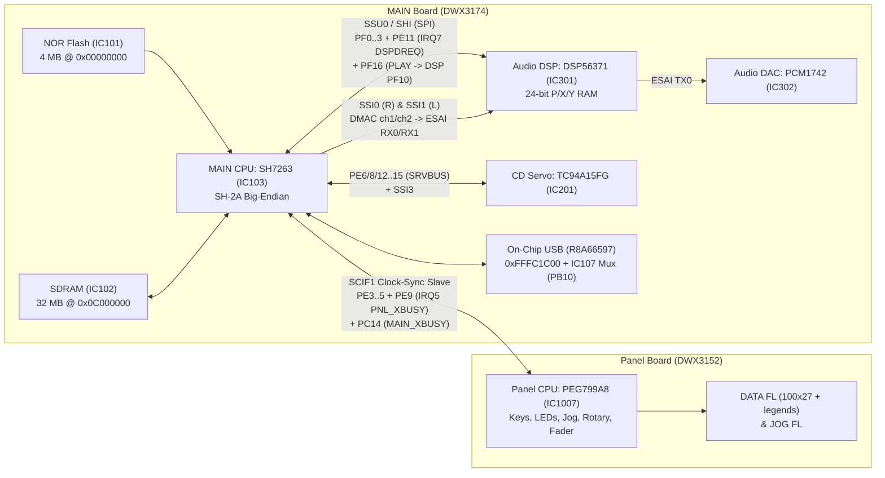

# CDJ-850 Reverse Engineering & Modding Reference

This document summarizes the reverse-engineered architecture, memory map, firmware container rules, inter-processor protocols, and key symbols of the Pioneer CDJ-850 (`C850MAIN.UPD` v1.13). It is designed as a developer reference for writing and validating new firmware mods for the CDJ-850.

> [!NOTE]
> All firmware addresses below refer to **CDJ-850 MAIN v1.13** (`C850MAIN.UPD`, SHA-256 `12ed34539d844e4c3d9230eebccbc31f0b6ff2ac4d813455084987c53beac3b7`). For hardware schematics, pinouts, service modes, and error codes, see [docs/cdj850-service-manual.md](cdj850-service-manual.md).

---

## 1. System Architecture & Memory Map

Unlike the SH-4A players (CDJ-2000, CDJ-2000NXS, CDJ-2000NXS2), the CDJ-850 uses a big-endian **Renesas SH7263 (SH-2A)** MAIN CPU (`IC103`, 200 MHz core / 66 MHz bus) paired with a **Motorola/Freescale DSP56371** 24-bit audio DSP (`IC301`) and a **Panel CPU** (`IC1007`, `PEG799A8`) driving both VFD displays (`DATA FL` and `JOG FL`).



### SH7263 Address Space

| Address Range | Size | Region | Description |
|---|---|---|---|
| `0x00000000–0x003FFFFF` | 4 MB | CS0 NOR Flash (`IC101`) | Bootloader (`0x000000`), recovery (`0x020000`), packed MAIN (`0x060000`), user settings (`0x3F8000`). Uncached alias at `0x20000000`. |
| `0x0C000000–0x0DFFFFFF` | 32 MB | CS3 SDRAM (`IC102`) | Unpacked MAIN firmware (`0x0C000000–0x0C38FFE0`), BSS/heap/buffers (`0x0C1C14DC+`), bootloader staging (`0x0DDEFA20`). |
| `0xFFF80000–0xFFF8FFFF` | 64 KB | On-Chip High-Speed RAM | Vector table (VBR), MP3 decoder buffers, SSI PCM blocks, RTOS pool 2 with ISR stubs, kernel/interrupt stack below `0xFFF90000`. See [On-Chip RAM Map](#on-chip-ram-map). The emulator maps 256 KB here; `0xFFF90000–0xFFFBFFFF` does not exist on the chip and is never touched. |
| `0xFFFF8000–0xFFFFBFFF` | 16 KB | On-Chip Retention RAM | Unused by boot and MAIN (see the map). |
| `0xFFFC1000` | 4 B | CCR | Cache control register. |
| `0xFFFC1C00–0xFFFC1CFF` | 256 B | USB (`R8A66597`) | On-chip full-speed USB host (USB-A) and function (USB-B) controller (SH7263 register offsets). |
| `0xFFFE0800–0xFFFE0FFF` | 2 KB | INTC | Interrupt controller (`ICR0/1/2`, `IRQRR`, `IPR01..IPR17`). |
| `0xFFFE1000–0xFFFE13FF` | 1 KB | DMAC | 8-channel DMA controller (`ch0` = SSI3 RX → CD-ROM decoder, `ch1` = SSI0 TX, `ch2` = SSI1 TX, `ch4` = CD-ROM decoder → CD sector ring, `ch7` = USB_DMA0). See [Uncached Buffers & DMA Map](#uncached-buffers--dma-map). |
| `0xFFFE3800–0xFFFE3FFF` | 2 KB | Ports / PFC | GPIO data (`PxDRL/H`), pin state (`PxPRL/H`), direction (`PxIORL/H`), pin function (`PxCRL/H`). |
| `0xFFFE7000–0xFFFE701F` | 32 B | SSU0 | Synchronous Serial Unit 0 — master SPI link to DSP56371 SHI (`PF3` = `DSPCS`, `PF7` = `DACCS`). |
| `0xFFFE8000` / `0xFFFE8800` | 64 B | SCIF0 / SCIF1 | `SCIF0`: ASCII debug UART (`115200 8N1`). `SCIF1`: clock-synchronous slave link to Panel CPU. |
| `0xFFFEC000–0xFFFEC00F` | 16 B | CMT | Compare Match Timer `ch0` (1 ms RTOS tick, vector `142`). Stock MAIN sets priority 7 in `IPR08[7:4]` at `0x0C0C6ABA`. |
| `0xFFFFC000` / `0xFFFFC800` | 32 B | SSI0 / SSI1 | Serial Sound Interfaces 0 (right) and 1 (left) feeding PCM blocks to DSP56371 ESAI. |

### On-Chip RAM Map

The SH7263 has 64 KB of high-speed RAM (`0xFFF80000–0xFFF8FFFF`, four 16 KB pages, one-cycle access from the CPU's instruction and data buses, and from the DMAC) and 16 KB of retention RAM (`0xFFFF8000–0xFFFFBFFF`, on the peripheral bus, several bus cycles per access; no instructions in its last 16 bytes) (hardware manual section 31).

How the map was made: both regions filled with a canary through QEMU's `loader` device before reset, dumped after boot to `NO DISC`, after USB WAV play and after USB MP3 play; every load, store and fetch logged by pc and 64-byte block; and every PC-relative literal in boot and MAIN that points into each range. **[emu + static]**

| Range | Contents | Users |
|---|---|---|
| `0xFFF80000–0xFFF803FF` | Live vector table: VBR = `0xFFF80000` at idle. The bootloader copies the flash vectors here; MAIN installs its handlers (175 entries point into MAIN, 23 at ISR stubs in pool 2). | Boot `0x11C`/`0x126`; MAIN `0x0C0C692C`, `0x0C0C699E`, `0x0C0C69D8`. |
| `0xFFF80400–0xFFF80497` | On-chip copy of the bootloader's cache routines (flash `0x544..0x5DB`: `cache_flush_enable` at `0xFFF80400`, range invalidates at `0xFFF80434`/`0xFFF8043E`). | Boot only. |
| `0xFFF80498–0xFFF86497` | Three 8 KB MP3 decoder work buffers at `0xFFF80498`, `0xFFF82498` and `0xFFF84498`, set up by `mp3_decoder_init` (`0x0C058DA0`). Untouched by WAV playback; MP3 playback makes ~91M loads and 49M stores there, from the decoder core at `0x0C13EC04–0x0C141FD8`. The last ~1.2 KB of the first and third buffers stayed unused in a 192 kbit/s stereo test. | MP3 playback. |
| `0xFFF86498–0xFFF86637` | SSI PCM blocks: two blocks, each with an 8-byte header, written by `ssi_prepare_pcm_block` (`0x0C076474`), which loads the address `0xFFF86498` itself. They are the sources of the SSI TX DMA: the feeder arms `ch1` from `0xFFF86498` and `ch2` from `0xFFF86568` (see [Uncached Buffers & DMA Map](#uncached-buffers--dma-map)). | Audio output. |
| `0xFFF86638–0xFFF8E79F` | RTOS pool 2 (`rtos_init_objects`, `0x0C0CDDCA`): kernel objects and task control blocks, plus one ISR wrapper stub per registered interrupt (0x40-byte objects holding a copy of the template at MAIN `0x0C0C68FC` and the handler pointers). The stubs are what runs at `0xFFF866E0`, `0xFFF87BAC`, `0xFFF8DC90`, `0xFFF8DE9C`... `idleTASK` spins reading the task objects here through `idle_task_state_scan` (`0x0C0B8ED8`). | Kernel, ISRs, idle task. |
| `0xFFF8E7A0–0xFFF8FC7F` | Never written in any run (boot, WAV, MP3); no literal in boot or MAIN points into it. Headroom between pool 2 and the stack below. | None seen. |
| `0xFFF8FC80–0xFFF8FFFF` | The reset stack (SP vector `0xFFF90000`), kept as the kernel/interrupt stack: RTOS dispatch (`0x0C0C672E`, `0x0C0C6F6C`, `0x0C0C7132`) and ISRs push here, while tasks run on SDRAM stacks (idle task: `r15 = 0x0CE49EC8`). Deepest write seen `0xFFF8FC80` (`0x0C0C6BB4`), at run time `0xFFF8FE00`. | Kernel, ISRs. |
| `0xFFFF8000–0xFFFFBFFF` | Retention RAM: still all canary after boot, WAV and MP3 play; no load, store or fetch; no PC-relative literal points into it. | None seen. |

For mods this leaves two candidates for fast data or code: the retention RAM (16 KB, but slower than the high-speed RAM and not yet checked on hardware for being enabled and usable as is) and the ~5 KB gap below the stack. The stack's worst case is unmeasured beyond these runs (CD playback, nested interrupts), so keep a margin of at least 1 KB above `0xFFF8FC80`. The MP3 buffers and pool 2 are taken. Not covered by these runs: CD playback, USB-B PC mode and the service modes.

### Uncached Buffers & DMA Map

SDRAM at `0x0C000000` is cached (write-back); the same chips at `0x2C000000` are not (see the cache paragraph in section 8.4 and [cdj850-cache-model.md](cdj850-cache-model.md)). The DMAC reads and writes memory, never the cache, so every DMA buffer needs either uncached access or cache maintenance. MAIN uses both, for different devices.

How the map was made: every load and store through the uncached mirror (`0x20000000–0x3FFFFFFF`) logged by pc and 256-byte block, cached loads and stores of the same blocks counted, and every DMAC arm (a `CHCR` store with `DE` = 1) logged with its `SAR`/`DAR`/`DMATCR`. Runs: boot to `NO DISC`, USB WAV play, USB MP3 play. Plus every PC-relative literal in MAIN that points into the mirror. **[emu + static]**

**Uncached buffers.** Only two SDRAM regions are ever reached through the mirror, and neither is ever touched through its cached address (zero cached loads or stores in every run):

| Range (uncached address) | Size | Contents | Users |
|---|---|---|---|
| `0x2DF79F50–0x2DFDFFFF` | 151 × `0xAD0` | **CD sector ring.** `cd_sector_ring_dma_init` (`0x0C060C4C`) clears the headers of 150 slots and programs DMAC `ch4` from the CD-ROM decoder's `STRMDOUT0` (`0xFFFC2204`) into the ring, `DMATCR` = `0x19578` longwords = 150 × 2768 B. `ch0` feeds the decoder from SSI3 (`SSIRDR_3` `0xFFFFD80C` → `STRMDIN0` `0xFFFC2200`). `cd_sector_ring_clear` (`0x0C0FAADA`) clears all 151 slots at boot (`memset`, `0x660B0` bytes, 104,492 longword stores). `cd_ring_slot_check` (`0x0C0FB5C8`) reads slot headers at `0x2DF79F50 + n × 0xAD0`. | CD playback **[static]**: the emulator never arms `ch0`/`ch4`, so in these runs the ring sees only the boot clear. |
| `0x2DFE0000–0x2DFFFFFF` | 128 KB reserved | **USB decoder output buffer.** `usb_decode_fill` (`0x0C0BF6BA`) passes `0x2DFE0000` to `usb_decoder_read` (`0x0C058C80`), pads short blocks with `memset`, then `pcm_rate_copy` (`0x0C0F95E6`) copies it into the PCM sector ring (cached). WAV: `wav_decode_block` (`0x0C058FF2`) copies the file data in with `memcpy_block32` and byte-swaps it in place (11M uncached accesses in the test run); used `0x0DFE0000–0x0DFE09FF`. MP3: `mp3_pcm_out` (`0x0C140B0C`) stores each granule as packed 16-bit stereo; used `0x0DFE0000–0x0DFE11FF` (one `0x900`-sample frame). | USB playback **[emu]**. AAC/AIFF not run; the rest of the 128 KB was not written through the mirror in these runs. |

Other mirror traffic is flash, not SDRAM: `flash_reset_cmd` (`0x0C08E80A`, `0x00F0` → `0x20000000`) and the unlock cycles at `0x20000AAA`/`0x20000554`; the bus delays `delay_flash_rd8` (`0x0C107932`, dummy byte reads of `0x20000000`, used by the CD servo bit-bang code, ~100k per boot) and `delay_flash_rd32x200` (`0x0C003294`, used by `usb_vbus_read_debounced` `0x0C0D1A2C`); and the bootloader's reads of its own flash image. **[emu + static]**

**DMA channels armed in these runs:**

| Channel | Source → destination | Per arm | Armed by |
|---|---|---|---|
| `ch1` | On-chip SSI PCM block `0xFFF86498` → `SSITDR_0` (`0xFFFFC008`) | 45 longwords, `CHCR` `0x1815` | `ssi0_dma_start` (`0x0C076288`), ~2,900× in a WAV or MP3 run |
| `ch2` | `0xFFF86568` → `SSITDR_1` (`0xFFFFC808`) | 45 longwords | `ssi1_dma_start` (`0x0C0763D8`) |
| `ch7` | USB FIFO ↔ **cached** SDRAM: receive into `0x0C9CD494` (6 KB; 674 arms in the WAV run, 85 in the MP3 run, so file data), `0x0DD2A5B8` (2 KB), `0x0C806xxx–0x0C808xxx` (16 × 512 B), `0x0C1E5088` and others; send from `0x0DDBDABC`, `0x0C8169E4..` and others | 128–1536 longwords; also, once per run, sends of 3 × 32768 longwords plus 1024 from `0x0D0691A4–0x0D0CA1A3` (not identified) | `usb_dma_start` (`0x0C019006`), which purges the buffer from the operand cache first |

No other channel was armed. So the rule MAIN follows is: the CD path (decoder DMA into SDRAM) and the USB decoder output are uncached-only; USB transfers use cached buffers with a purge; SSI output DMA comes from on-chip RAM, which is never cached.

For mods: read and write `0x0DF79F50–0x0DFFFFFF` only through the `0x2Dxxxxxx` mirror. A cached access would leave a line that goes stale under the next DMA (a read), or that is written back over DMA data later (a write). `scripts/cache/cache_run.py` reports both. A mod that adds its own DMA into SDRAM must either use the mirror or purge the range, as `usb_dma_start` does.

### SH-2A Architectural Quirks for Mod Authors
1. **Big-Endian Only**: Instructions and literal pools are big-endian (`sh-elf-as -isa=sh2a -big`; the SH-4 assembler rejects SH-2A-only opcodes such as `movi20` and `movu.b`).
2. **32-Bit SH-2A Instructions**: The firmware uses SH-2A 32-bit instructions extensively:
   - `movi20 #imm20, Rn` (`0000nnnniiii0000` + 16-bit low word) and `movi20s #imm20, Rn` (`<< 8`).
   - 32-bit `mov.b/w/l` and `movu.b/w` with 12-bit displacements (`0011nnnnmmmm0001` + subword).
   - 32-bit bit operations (`bset.b`, `bclr.b`, `bld.b`, `bst.b` on `0011nnnn0iii1001`).
   - 16-bit SH-2A instructions: `rts/n` (`0x006B`, return without delay slot), `jsr/n @Rn` (`0x4n4B`, call without delay slot), `nott` (`0x0068`, invert `SR.T`).
3. **No `SR.RB` / `SR.BL` / `SR.MD` Bits**: Unlike SH-4, SH-2A has no general-register bank bit (`RB`) in `SR` and no MMU. All code runs flat in physical memory (`0x0Cxxxxxx` cached SDRAM, `0x2Cxxxxxx` uncached SDRAM alias).

---

## 2. Firmware Container (`C850MAIN.UPD`), Flash Layout & Bootloader

`C850MAIN.UPD` (2,156,300 bytes in v1.13) is a flat binary image with **no section manifest and no Motorola S-records**.

### Container & 4 MB NOR Flash Map

| Flash / File Offset | Size | Region | Contents |
|---|---|---|---|
| `0x000000–0x01FFFF` | 128 KB | Stage-1 & Stage-2 Bootloader | Reset vectors (`PC = 0x00000100`, `SP = 0xFFF90000`); stage-2 unpacker at `0x010000` (copied to SDRAM `0x0DDEFA20` at reset). |
| `0x020000–0x03FFFF` | 128 KB | Recovery Image | Standalone packed recovery firmware (`BE32` length `0x01EC37` at `0x020000`, stream, `BE16` sum16 `0x7079`). Booted if MAIN fails checksum. |
| `0x040000–0x05FFFF` | 128 KB | Erased Gap | `0xFF` bytes. |
| `0x060000–0x06001F` | 32 B | MAIN Label | `"CDJ-850 MAIN\0\0\0\0"` (`0x060000..0x06000F`) + `"1.13\0..."` (`0x060010..0x06001F`). |
| `0x060020–0x060023` | 4 B | Packed Length | `BE32` LZSS stream byte count (`0x0019E6E6` = 1,697,510 bytes in stock v1.13). |
| `0x060024–0x1FE709` | `len` | Packed MAIN Stream | Okumura LZSS stream (ring size `4096`, pre-filled with `0x20`, initial write cursor `4078`). |
| `0x1FE70A–0x1FE70B` | 2 B | Bootloader Checksum | `BE16` 16-bit plain byte sum (`sum(bytes) & 0xFFFF`) over `0x060020 .. 0x060024 + len` (length word + stream; `0xFB71` in stock v1.13). |
| `0x1FE70C–0x20E70B` | 64 KB | File Tail Padding | `0x10000` zero bytes in `.UPD` file (`0xFF` in flash past the programmed sectors). |
| `0x200000–0x3EFFFF` | 1.93 MB | Unused Flash Window | Erased (`0xFF`) in stock. The MAIN updater erases/programs up to `0x3EFFFF` (57 × 64 KB sectors from `0x060000`), so a repacked MAIN may grow into it (see below). |
| `0x3F0000–0x3FFFFF` | 64 KB | Persistent Settings | Never touched by firmware updates. User UTILITY settings & key states live at `0x3F8000` (`PERSIST=1` preserves this sector). |

### Bootloader Verification & Unpack (`boot.bin`)
1. At power-on reset (`0x00000100`), stage 1 initializes BSC/SDRAM, copies stage 2 (`0x010000`) to `0x0DDEFA20`, and jumps to it.
2. Stage 2 (`0x010160`) reads `len = BE32 @ 0x060020` and `want = BE16 @ (0x060024 + len)`.
3. It sums every byte in `0x060020 .. 0x060024 + len` (`0x0100B2`).
4. If `(sum & 0xFFFF) == want`, it LZSS-decodes exactly `len` bytes into SDRAM at `0x0C000000–0x0C38FFE0` (3,735,520 bytes) and executes `jsr @0x0C000000`.
5. If the checksum mismatches, it runs the same check and unpack on the recovery image at `0x020000`.

**Size limit: the packed MAIN may end anywhere up to `0x3F0000`** (`c850_repack.MAIN_END`), not just below the `0x200000` where the stock layout stops. Stage 2 takes the length as is and the decoder only counts it down (its only state is a 4 KB ring at `0x0DDEFC1C`); the updater programs `0x060000–0x3EFFFF` whatever the file length; and MAIN's only other flash writers (`0x0C08EE60`, `0x0C08F32A`) erase and program just the settings/log sectors `0x3F8000`, `0x3FA000`, `0x3FC000`, `0x3FE000`. Emulator proof: a `loader` build carrying 1,507,292 random bytes (packed MAIN ending at `0x370E5F`, a `0x380E5F`-byte file labelled `1.14`) boots to `NO DISC` with its payload intact, and installs from stock `1.13` through the service-mode USB update (`COMPLETE!`, flash `0x060000–0x3F0000` equal to the file, boot region untouched).

### Service-Mode USB Updater (`0x0C08EC44`)
- Holding **USB SELECT + RELOOP** at power-on enters USB update mode in MAIN.
- `0x0C08F3C2` reads `C:/C850MAIN.UPD` into a 4 MB buffer at `0x0C1E8E5C` (pre-filled with `0xFF`). A state nibble selects the flash-task mode. The service-mode USB trace reached `FlashTask` (`0x0C08E92C` → `0x0C08EC44`) in **mode 6**:
  - Mode 6 erases and programs 57 × 64 KB sectors (`0x060000–0x3EFFFF`), leaving the bootloader (`0x000000–0x05FFFF`) and settings (`0x3F0000–0x3FFFFF`) untouched.
  - **Version skip rule** (traced, `0x0C08EC60..0x0C08ECCA`): the updater copies the file's label bytes `0x060010..0x060014` to `0x0C08EE78` and **skips flashing, reporting `COMPLETE!` with nothing written, only when all of** `file[0] >= '1'` (`cmp/ge #0x31` on the zero-extended byte), mode = 6, `memcmp(file+2, running+2, 2) == 0` (the two chars after the dot, via the pool function at `0x0C08EE80`) and `file[0] == running[0]`. The dot is never compared, and a file whose label starts below `'1'` is always written. `c850_repack.installs_over(file, running)` is this rule. When repacking by hand, `c850_repack.py pack --version D.DD` sets the label.
  - After each sector erase (`0x0C08E842`) and word program (`0x0C08E8AE`), the updater polls **flash `RY/BY#` on Port C pin `PC2`** (`0xFFFE391E` bit 2 == 1).
  - **Running version** = `0x0CE6D242` (pool `0x0C08EE7C`), 16 bytes filled at boot by `0x0C0B8D68`: `memset` 0, then `sprintf(0x0CE6D242, "%s", flash 0x060010)` (pool `0x0C14F6FC` = `0x60010`), i.e. the label of the MAIN in flash: `1.13` after a stock boot, `0.13` after booting a `patch_update.py` build **[emu]**. Readers: the `NOW UPDATING` line `"  <running>  > <file> "` (4 chars each, `0x0C068B30`/`0x0C068B76`), the version screen (`Ver ` + 8 chars at `0x0C06C802`, `Main ` + 7 chars at `0x0C06E320`), and the updater. The numeric version `0x0CE6D240` (u16 = 113, written as a constant at `0x0C0B8D86`) does not come from the label.
- Mode 5 programs 63 × 64 KB sectors starting at `0x000000`, including the boot region. Its entry path remains unresolved. Both modes preserve the settings sector.

### Install and roll back (emulator-verified)
- **Label:** `patch_update.py --model cdj850` labels a modded file **`0.13`** by default (`c850_repack.mod_label`: the stock label with its first digit 0). By the traced rule that one label (a) installs over stock `1.13` (`'0' < '1'`: always written), (b) installs over a deck already running any `0.13` mod build, a different mod set or the same rebuilt (again always written; no fixed label `>= '1'` can do that, since it would equal itself), and (c) is rolled back by the shipped `C850MAIN.UPD` (`1.13` vs running `0.13`: first chars differ). The deck shows `NOW UPDATING` with `0.13`/`1.13` and the version screen reads `Ver 0.13`, so a modded deck is told apart from a stock one. `--version D.DD` sets another label (with a first char `>= '1'` it is skipped wherever the deck runs the same label), `--keep-version` keeps the input's (`1.13`: skipped on a stock deck, `validate.py` notes it). The label is outside the summed bytes; `validate.py` allows exactly the version field to change and reports what the updater will do with it. A `0.DD` input counts as firmware `1.DD` for the mods' version check (re-patching a modded file works).
- **Install:** the `0.13` file from `patch_update.py`, unchanged, installs over the stock emulated deck through USB SELECT + RELOOP (`COMPLETE!`, flash `0x060000–0x3EFFFF` equal to the file padded with `0xFF`, boot region untouched) and boots as `0.13` **[emu]**. Negative control: the same file relabelled `1.13` is skipped on that deck (`NOW UPDATING 1.13 > 1.13`, `COMPLETE!`, flash unchanged).
- **Rollback:** on the `0.13` deck the stock `C850MAIN.UPD` installs, and flash `0x060000–0x3EFFFF` equals the stock file padded with `0xFF` (what a stock install leaves; the shipped emulator flash `extract/cdj850/flash_cdj850.bin` matches it over the packed MAIN `0x060000–0x1FE70C`, and has `0xFF` instead of the file's 64 KB zero pad). Boot region and settings sectors are untouched; the next boot is stock (no loader payload at `0x0DE00000`, every mod-written MAIN range stock in SDRAM, version `1.13`). `scripts/test/cdj850_rollback.py` runs the whole flow.
- **Mod code in service mode: none runs** (service gate, section 8.5). Before the gate, the player task kept ticking in service mode, so `hot_cues`' key filter, state tick and LED hook ran while the updater flashed and the display BPM hook (`bpm999`/`bpm_decimals`) ran before it started. With the gate, the rollback run arms gdb breakpoints on every function of the payload and every halfword of the mods' cave routines (not the trampolines, which hold the moved stock code) and sees **zero** hits before and during the update, while the gates themselves are hit and take the stock path; on the normal modded boot a breakpoint on `hot_cues_keys` hits on a key press (positive control) **[emu]**. The `hot_cues` byte `+0x22 = 0x5A` stays in the settings record after a rollback and is ignored by stock (HISTORY name reads normally).

## 3. RTOS & Task Table

MAIN runs a TOPPERS/µITRON-style real-time kernel. Tasks are registered from static 20-byte descriptors (`entry, priority, stack_size, stack_ptr, name_ptr`).

### Core RTOS Primitives
| Address | Name / Role | Notes |
|---|---|---|
| `0x0C0CDDCA` | Kernel object initializer | Allocates from Pool 1 (SDRAM `0x0CEEFA20`) and Pool 2 (on-chip RAM `0xFFF86638`, head pointer `0x0CE4A330`). |
| `0x0C0CB640` | `prcv_mbx` | Receive from mailbox (used by audio task on mailbox 2). |
| `0x0C0D7464` | `audio_send_cmd(cmd, flag, ...)` | Formats a command packet and sends it to the audio task via `snd_mbx(2)`. |
| `0x0C08EFE0` | Settings getter | Reads user settings loaded from flash into RAM at `0x0C9DA23C`. |
| `0x0C08F294` | Factory defaults loader | Initializes default settings (including VINYL mode bit 7 of `0x0C9DA23C`). |

### Boot-Critical Task Roots (`mods/bootcrit.py`)
`mods/validate.py` walks the call graph from the hardware vectors (`0x100, 0x400, 0x600, 0x800`) and the following CDJ-850 task descriptors to guarantee that no mod overwrites code needed to boot, talk to the panel/display, mount USB, or run a recovery firmware update:
- `initTask` (`0x0C0B8DDC`)
- `idleTASK` (`0x0C0B8EA2`)
- `FlashTask` (`0x0C08E92C`)
- `serialTask` (`0x0C0FA954`)
- `usbTask` (`0x0C10B564`)
- `DjControlTask` (`0x0C014FC8`)
- `DisplayTask` (`0x0C061454`)

---

## 4. MAIN Key Functions & Global State Map

### Player, Transport & Pitch (`DjControlTask`)

| Address | Symbol / Type | Description |
|---|---|---|
| `0x0CE6D25A` | `u8 is_usb_or_data_mode` | `1` in USB/data mode (set by `FUN_0C0EEFB0`), `0` in CD mode. Mirrors `0x0CE6D25B`. |
| `0x0CE6D252` | `u8 active_source_index` | Source index (`2` = USB). |
| `0x0CE6D25F` | `u8 player_state` | `0x0CE6D25D + source_idx`: `0x0A` = USB browse, `2` = loading, `3` = playing, `4` = paused (CDJ mode / CUE), `5` = paused/braking (VINYL mode), `6` = cued. On USB `4` = a loop is playing and `5` = paused in CDJ jog mode (see §4b). |
| `0x0CE6CA9D` | `u8 speed_substate` | `0` = normal pitch-tracked, `1` = VINYL scratch, `2`/`0x12` = instant start with `HOLD=1`, `3` = hold/cued, `4`/`0x24` = VINYL touch/brake/release ramp. |
| `0x0CE6D0DD` | `u8 time_mode_remain` | `1` = `REMAIN`, `0` = elapsed `TIME` (toggled by `0x0C0D9194`). |
| `0x0CE6D0DE` | `u8 jog_mode_vinyl` | `1` = `VINYL` (factory default), `0` = `CDJ` mode. |
| `0x0CE6D0DF` | `u8 auto_cue_enabled` | `1` = `A.CUE` on, `0` = off (toggled by holding TIME MODE at `0x0C0D91E4`). |
| `0x0CE6D0E0` | `u8 master_tempo_enabled` | `1` = `MASTER TEMPO` on, `0` = off (toggled by `0x0C0D8D78`; sets bit 22 `0x400000` on DSP speed word). |
| `0x0CE6D0E1` | `u8 tempo_range` | `1` = ±6%, `2` = ±10% (default), `3` = ±16%, `4` = `WIDE` (±100%). Cycled by `0x0C0D8DC0`. |
| `0x0CE6D0F1` | `u8 play_intent_latch` | Set to `1` when PLAY is pressed during load or in VINYL brake mode. |
| `0x0CE6D0F2` | `u8 vinyl_brake_flag` | `1` = ramping speed down to `0` (brake/touch), `0` = ramping speed up to target pitch. |
| `0x0CE6D0F3` | `u8 jog_touched` | `1` while the platter top is touched (`0x0C0ED0B4` / `0x0C0ED10C`). |
| `0x0CE6D0F5` | `u8 pitch_force_refresh` | Set to `1` by MT/Tempo Range buttons (`0x0C0D8E4E`) to force a pitch/HOLD update even when fader ADC is unchanged. |
| `0x0CE6D0FD` | `u8 nav_view_selector` | `0` = `INFO` (default loaded view), `1` = `BROWSE`, `3` = `TAG LIST`. |
| `0x0CE6CA48` | `u16 pitch_fader_raw` | Incoming SCIF1 fader sample (center = `0x8000`, written at `0x0C0ECF12`). |
| `0x0CE6CA4A` | `u16 pitch_fader_center` | Incoming SCIF1 fader center reference (`0x8000`, written at `0x0C0ECF1A`). |
| `0x0CE6C930` / `32` | `u16 pitch_prev` / `pitch_cur` | Filtered pitch values compared by `FUN_0C0D59B8` to detect fader movement. |
| `0x0CE6C938` | `u16 dsp_shi_word0_flags` | Bit 15 (`0x8000`) = `HOLD` (tell DSP to apply speed immediately without ramping). |
| `0x0CE6C940` | `u32 dsp_target_speed` | 24-bit fixed-point playback speed sent to DSP (`0x080000` = `1.0x`, `0x100000` = `2.0x`, bit 22 `0x400000` = Master Tempo / Reverse flag depending on word). |

### Key Transport & Audio Functions
- **`FUN_0C0D59B8` (`0x0C0D59B8`)**: Master speed & `HOLD` calculator called on every player tick.
  - Computes target speed in `0x0CE6C940` from the tempo fader, range (`0x0CE6D0E1`), jog bend, or VINYL start/brake curves (`FUN_0C0D5FBA` / `FUN_0C0D5FEC`).
  - **USB WIDE math note**: Two branches in `FUN_0C0D59B8` check `*0x0CE6D25A != 1` before selecting the overflow-safe `WIDE` multiplier (`0x51EB851F`), because stock firmware only allows `WIDE` on CD (`*0x0CE6D25A == 0`). Enabling `WIDE` on USB requires patching those two conditional branches (`tempowidemath1` and `tempowidemath2` in `mods/tempo_wide/cdj850/patch.py`).
- **`FUN_0C0D8D78` (`0x0C0D8D78`)**: Handler for `TEMPO` (range cycle at `0x0C0D8DC0..0x0C0D8DDE`) and `MASTER TEMPO` (`0x0C0D8E4E`).
- **`FUN_0C0DEB50` (`0x0C0DEB50`)**: `PLAY/PAUSE` button handler. Note that **the CDJ-850 automatically starts playing a track as soon as load completes** (`0x0C0EAE2A..0x0C0EAE7A` transitions to state `3` and sends audio command `(1, 1)` once 75 sectors are buffered); pressing PLAY on an auto-playing track therefore transitions `3 -> 5` (pause/brake).
- **`FUN_0C0DC996` (`0x0C0DC996`)**: `CUE` button handler.
- **`FUN_0C0DD978` (`0x0C0DD978`)**: Main player tick and jog pitch-bend / scratch velocity processor.
- **`FUN_0C015BD4` / `FUN_0C015B18`**: Builds / clears a 4-segment audio loop (`0x0C1C1460` / `0x0C7F6674`).

### Idle Auto-Standby (`FUN_0C0EF844`, table `0x0C18CCDC`)
- **Seconds counter**: `FUN_0C0EF844` (called by `bsr` from `FUN_0C0EF8C8`, the power/standby part of the 1 ms tick routine `0x0C0B92CC`, which reaches it through its pool word `0x0C0B9310`; **[emu]** one call per increment of the 1 ms tick counter `u32 0x0CE49F54`, see `payload_demo`) adds 1 to a u32 at `0x0C1E10B0` on each call and, after 1000 calls, adds 1 to the u16 seconds counter at `0x0C1E10AE`. Measured in the emulator: the standby request lands about 60 s after the count starts, which fits 1000 calls per second.
- **Limit**: the request fires when the seconds counter reaches `table[idx]`, a u16 BE at `0x0C18CCDC + 2*idx`, with `idx = (UTILITY byte 0x0C9DA23E >> 4) & 7`. Stock entries: `idx 0` = 0 (AUTO STANDBY OFF, gated out before the compare), `idx 1` = `0x3840` = 14400 s = 4 hours (AUTO STANDBY ON). Indices 2..7 are not used by the UTILITY setting.
- **Reset**: while the gate fails (`FUN_0C0EF7D6`, or the OFF index), the 6 bytes at `0x0C1E10AE` are cleared through `FUN_0C1106EC`. A TEMPO press in the emulator reset the seconds counter (24 to 8 in the test run), so key activity restarts the count.
- **Request**: on expiry the state byte `0x0C1E10AC` goes to `4`. State 4 calls `FUN_0C0EEB12(1)`, which sets bit 0 of the status byte at `DAT_0C0EEC90+0x15`; that bit becomes byte 8 of the status page-2 frame (§5).
- **Mod**: `mods/auto_standby` (`CDJ850_STANDBY_MINUTES`, default 20, 1..1092) rewrites only the `index 1` u16. Playing/source gates, the OFF index and the request path are unchanged.

### BPM Words, Clamps & Readers (`mods/bpm999`)
- **Base tempo** `0x0C9D23EC`: `u16 BE` tenths of BPM (`1800` = 180.0). Written by the beat-grid setter (`FUN_0C073788` clamp `movi20 #0x708` at `0x0C0737D6`), the auto counter (`FUN_0C0726EC`, `FUN_0C072824`, reject `> 0x710`, clamp `0x708`) and `FUN_0C072930` (reset to 0).
- **Whole pitched BPM** `0x0C9D23F0`: `u16 BE`, `round(round(base/10) x (10000+pitch)/10000)`. Written by `FUN_0C0D9B44`, the auto counter tails and the grid setter. No clamp in memory.
- **Staging BPM** `0x0C9D0AE0` (TX page 0x01 bytes 8..9): written by `display_stage_bpm` (`0x0C064118`, tail `0x0C0642AA..0x0C0642B8` hooked by `bpm999`) and `FUN_0C068304` (boot-critical, unpitched). Read only by `panel_tx_build_status_pages` (`0x0C065D9E`, boot-critical, not touched).
- **Sync/tempo range** `FUN_0C0D1C42`: base outside 60.0..(199.9 stock, 999.0 with `bpm999`) stores 130.0 in the sync field. `FUN_0C0D1D56`, `FUN_0C0D1CE6` compute pitch as `(target x 10000) / base - 10000` and cast to `short` before the +-16% test: a wrap is possible when target/base is about 7.5 or more.
- **Readers of 0x0C9D23EC** (safe / needs change / changed): `display_stage_bpm` safe (staging, changed by hook); `FUN_0C072930` safe (zeroes); `FUN_0C0726EC`, `FUN_0C072824` kept (detector window); grid setter (`0x0C0736xx`) safe; `FUN_0C073788` changed; `upd_load_from_cd`, `upd_load_from_usb` safe (service update uses the word as scratch: writes 0 / 200); `FUN_0C06F320` formatter needs check (thousands digit can be 1..9 at 999.0); `FUN_0C0715F6` not checked; `FUN_0C0D1B58`, `FUN_0C0D1BDE`, `FUN_0C0D1E40` safe (copies into sync fields); `FUN_0C0D1C42` changed (range); `FUN_0C0D1D56`, `FUN_0C0D1CE6` safe in range, short-cast wrap noted above; `FUN_0C0D9B44` safe (no overflow: 999 x 20000 < 2^31), output clamped at display; `FUN_0C0E54AE` safe (whole BPM for link/MIDI, `0x82` sentinel for 0; check the consumer's range); `FUN_0C0E9E68`, `FUN_0C0EA8AE` safe (signed-16 compares up to 9990); `FUN_0C0EF112`, `FUN_0C0EB46E` safe (zero); `player_handle_play_pause`, `FUN_0C0E2A2C`, `FUN_0C0E0F34`, `FUN_0C0E2414`, `FUN_0C0EB704`, `FUN_0C0EC73C`, `FUN_0C0EBA58`, `FUN_0C0EBF0E`, `FUN_0C0EC128`, `FUN_0C0DE680`, `FUN_0C0DB2E8`, `FUN_0C0D60BC`, `FUN_0C0E8ECC`, `FUN_0C0EB660` not checked (xref pattern only).
- **Pitch word** `0x0CE6CA50`: `s16`, 1/100 % (FUN_0C0D9B44, pool `0x0C0D9E9C`; clamped to +-6/10/16 %, WIDE +-100.00 %); the byte `0x0CE6CA4C` (pool `0x0C0D9E98`) is the WIDE flag that selects the x50 scale. **[emu]**: fader moved, `0x0C9D23F0` follows `round(round(base/10) x (10000 + 0x0CE6CA50)/10000)`.
- **Tempo fader to pitch word** (FUN_0C0D9B44, **[static]** + **[emu]** stock 1.13): fader sample `0x0CE6CA48` (wire bytes 5..6) against the centre `0x0CE6CA4A` (wire bytes 7..8, `0x8000`). With `k = |raw - 0x8000|` the pitch is `+S*k/32000` below centre and `-S*k/31999` above, integer division (truncating), then a per-range quantum. `S` is the u16 scale at `0x0CE6CA4E` (pool `0x0C0D9E90`), written by `FUN_0C0E4E52(range)`: range 1 (+-6) S=300 and output `2*floor(S*k/32000)`; range 2 (+-10) S=200 and `5*...`; range 3 (+-16) S=320 and `5*...`; range 4 (WIDE, also `0x0CE6CA4C`=1) S=200 and `50*...`, clamped at +-10000. So the steps are **0.02 % at +-6** (300 levels per half travel), 0.05 % at +-10 and +-16, 0.5 % on WIDE. Emulator, stock flash, USB, CDJ mode: 17 of 24 +-6 samples equal the formula exactly, the other 7 are one 0.02 % level off (raw `0x7F80..0x7F95` read 0 instead of 2, `0x8080` read 0 instead of -2, `0x0300` read 598 instead of 600); every reading is even. +-10 (5/5), +-16 (8/8) and WIDE with tempo_wide (12/12) match. Display: `display_stage_pitch` (`0x0C063FD6`) shows hundredths on +-6/10/16 and tenths on WIDE; the range badge is chosen from `0x0CE6CA4E`.
- **Mod**: `mods/bpm999` (grid and range DataPatches, display clamp hook), `mods/bpm_probe` (BPM 199 and frame 75..99 hook on the same span, default off; counters at `0x0DDF0C40/44`, unused SDRAM).

### Audio Ring Buffer & SSI Feeder
- **PCM Sector Ring (`0x0C1E8E5C–0x0C74B05C`)**: Holds `2400` (`0x960`) entries of `0x930` bytes each (2,352 bytes = 1 CD-DA sector = 588 stereo 16-bit big-endian frames). Both CD and USB WAV/MP3/AAC decoders write into this ring.
  - `0x0C7F645C`: Current play sector index (`READ_INDEX`, 16-bit halfword; `0x0C7F6466` in state 4).
  - `0x0C7F645E`: Current write sector index (`WRITE_INDEX`, 16-bit halfword).
  - `0x0C7F6470` / `0x0C7F6474`: Byte read / write pointers (`base + idx * 0x930`, set by `FUN_0C005C44`).
- **Stream Start / Stop**:
  - `FUN_0C005B14` ("start DSP stream"): Clears stale `IRQ7` flag (`0xFFFE0806` bit 7), unmasks `IRQ7` priority to `7` (`IPR02` low nibble at `0xFFFE081A`), and drives **Port F pin `PF16` (`PLAY`) high** (`PFDRH |= 1`).
  - `FUN_0C005BB6` ("stop DSP stream"): Drives `PF16` low (`PFDRH &= ~1`).
- **IRQ7 (`DSPDREQ`) Feeder (`0x0C076624`, vector `71`)**:
  - Triggered whenever the DSP pulls `PE11/IRQ7` (`DSPDREQ`) low.
  - At stock priority 7, IRQ7 wins arbitration against a pending CMI0 (vector 142) by vector number when both requests are eligible at the same priority.
  - Masks `IRQ7` (`IPR02` low nibble = `0`, written at `0x0C07664C`), calls `FUN_0C076474` to split the next 84 stereo frames into 45 32-bit words per SSI channel (`[0, header, 42 packed sample pairs, 0]`, where `SSI0` right header = `0xCE5C0000` and `SSI1` left header = `0xCA5A0000`), and starts DMAC `ch1` (`SSI0_TX`, `DMARS0 = 0x2300`) and `ch2` (`SSI1_TX`, `DMARS1 = 0x0027`).
  - When DMAC `ch2` finishes (`DEI2` ISR `0x0C076444`, vector `116`), it re-enables `IRQ7` (`IPR02` low nibble = `7`, written at `0x0C07646C`) so the DSP can request the next block.

---

## 4b. Player Control Flow: Keys, Loops, Cues, Display Text

Traced on MAIN 1.13 (USB source, rekordbox export built by `tools/baken/baken`, GRID128 = 128.00 BPM, 64 bars, memory cues at bars 3/7/12/40, hot cues A/B/C at bars 2/5/9). Tags: **[emu]** = seen in the emulator (RAM over QMP, gdbstub watchpoints), **[static]** = Ghidra only. Driver: `scripts/debug/cdj850_trace.py` (stick builder, key presses, RAM dumps, gdbstub watchpoints). Note: QEMU's watchpoint stop PC is not exact on this target; the reported `PR` (caller) is reliable. Function names below were added to the Ghidra project.

### Units (read this first)
- **Position = CD frame = 1/75 s = one 2352-byte ring sector = 588 samples.** Every player-level position (cue, loop in/out, memory cue list, `D1C0`, `D158`, track length) is a `u32` frame count from the track start. **[emu]** (memory cues at 3.750/11.250/20.625/73.125 s load as 281/843/1546/5484 = `floor(ms*75/1000)`; GRID128 length 121 s = 9075 frames.)
- **M/S/F** = `frames_to_minutes_seconds_frames` (`0x0C003E56`): M = f/4500, S = (f/75)%60, F = f%75. Code also rebuilds frames as `M*0x1194 + S*0x4B + F`.
- **Ring sector ↔ frame:** the PCM ring (2400 sectors, §4 Audio Ring) is a streaming window. Sector-table entry `0x0C750C3C + ring*16`, `+0` u32 = absolute frame held by that slot (`ring_sector_to_frame` = `FUN_0C00851E`; when `*0x0C7F66C8 == 1` it decodes `entry+7` instead). **[emu]**: after the first wrap entry 0 held frame 2400; after a CALL jump the ring restarts at index 0 while the frame is 2083, so ring index ≠ frame.
- **Current play frame:** `u32 0x0C7F647C` (copied into `D1C0` in state 6) **[emu]**. Ring read index `0x0C7F645C` (u16).
- **Grid time:** `ms = frames*1000/75` (`FUN_0C073788` uses `(frames*1000) * 0x1B4E81B5 >> 35`); back: `frames = ms*75/1000`.
- **Half frames:** no position finer than one frame was found in the player, cue list, loop records or ANLZ conversion. The only sub-frame quantity is the feeder's byte pointer `0x0C7F6470`, which loop wraps and seeks reset to sector boundaries (`base + sector*0x930`). Half-frame cue/jog needs a new unit or a byte-offset path in the feeder **[static]**; see section 12 for the feasibility trace.
- **Paused (state 5, CDJ jog mode):** the frame stays fixed (`0x0C7F647C` = 609) while the ring read index cycles over about 12 sectors (597..608), the pause stutter buffer. **[emu]** Jog-search step size in pause was **not** measured (one `jog+1` count did not move the frame); `player_tick_jog` = `FUN_0C0DD978` is not traced.

### 1. Key input path
| Stage | Address | What |
|---|---|---|
| RX raw | `0x0CE6C960` | SCIF1 RX bytes (RX1 at +0, RX2 at +0x10). |
| Unpack | `panel_unpack_buttons` `0x0C0D610C` (also inlined in `FUN_0C0D60BC`) | Copies RX1 bytes 1..14 to `0x0CE6C980+0..0xD` and RX2 bytes 1..12 to `+0xE..+0x19`. Words: `+0xC` word0 (RX1 13..14), `+0xE` word1, `+0x10` word2, `+0x12` word3, `+0x14` word4 (§5 masks). `FUN_0C10284C` is only a 100-entry debug key log. |
| Accepted | `0x0CE6C9F2` (+0xE/+0x10/+0x12 = words 1..3, +0xC = word0 & 0x20) | Debounced copy, written when the state changed and the player gates allow it; sets **new-keys flag `u8 0x0CE6D132` = 1**. |
| Remap | `panel_keys_to_internal_words` `0x0C0ECCB4`, called only by `bsr` at **`0x0C0ED1FA`** (delay slot `mov r0,r4`) in the DjControlTask loop when `0x0CE6D132` is set, directly before `FUN_0C0EC73C` (state tick, `bsr` at `0x0C0ED274`) | Builds the **internal "held" words K0/K1/K2** from `0x0CE6C980` (table below). Also copies pitch/jog fields. |
| Held state | **K0 `u16 0x0CE6CA08`, K1 `0x0CE6CA0A`, K2 `0x0CE6CA0C`** (`0x0CE6CA0E` cleared) | Level state: bit set while the key is held. **[emu]**: BEAT SELECT held → `K0=0x0040`; + RELOOP → `0x0440`; BEAT 8 → `K1=0x0080`; CALL◀/▶/DELETE/MEMORY → `K2=0x0100/0x0200/0x0400/0x0800`; LOOP IN/OUT → `K0=0x1000/0x0800`. |
| Previous | **`0x0CE6CA22/24/26`** | Copied from K0..K2 at the end of each player cycle by `player_keys_latch_prev` (`0x0C0E49CC`, tail-called from `FUN_0C0D79D8`). |
| Edge rule | all handlers | press = `(K & m) != (prev & m) && (K & m) == m`; release = `(K & m) != (prev & m) && (K & m) == 0`. Hold timers are per handler (e.g. DELETE `0x0CE6CA7E` = 5000). |
| UI lock | `u8 0x0CE6D151` | When 1, `FUN_0C0EC73C` saves K0..K2 to `0x0CE6CA14` and masks K0 &= 3, K1 &= 4 or 0x380C, K2 &= 0x100B. |
| Dispatch | `player_key_dispatch_by_state` `0x0C0D7800` (switch on `player_state` `0x0CE6D25D+src`) | state 3/5 → `0x0C0DEB50` (named `player_handle_play_pause`, actually the whole play-state key handler), 4 (looping) → `keys_state4_looping` `0x0C0E0F34`, 6 (cued) → `0x0C0E1D54`, 7 → `0x0C0E2414`, 8 → `0x0C0E2A2C`, 9 → `0x0C0E36BC`, 10/12/14 → `0x0C0E3ED8`, other → `0x0C0DE75E`. |
| Common keys | `player_handle_tempo_and_time_buttons` `0x0C0D8D78` (all states) | TEMPO, MT, VINYL, TIME, **MEMORY, DELETE, CALL◀/▶** (below). |

Internal bits (from `0x0C0ECCB4`):

| Word | Bits |
|---|---|
| K0 `0x0CE6CA08` | `0x8000` REV, `0x4000` CUE, `0x2000` PLAY, `0x1000` LOOP IN, `0x0800` LOOP OUT, `0x0400` RELOOP/EXIT, `0x0040` BEAT SELECT, `0x0020` SEARCH◀◀, `0x0010` SEARCH▶▶, `0x0008` TRACK▶▶\|, `0x0004` \|◀◀TRACK, `0x0002` DISC, `0x0001` USB |
| K1 `0x0CE6CA0A` | `0x8000` TAG TRACK, `0x2000` INFO, `0x1000` TAG LIST, `0x0800` BROWSE, `0x0400` VINYL, `0x0200` TEMPO, `0x0100` MASTER TEMPO, **`0x0080` BEAT 8, `0x0040` BEAT 4, `0x0020` BEAT 2, `0x0010` BEAT 1**, `0x0008` BACK, `0x0004` EJECT |
| K2 `0x0CE6CA0C` | `0x2000` TIME MODE, `0x1000` MENU, `0x0800` MEMORY, `0x0400` DELETE, `0x0200` CALL▶, `0x0100` CALL◀, `0x0008` USB STOP, `0x0001` LINK |

**BEAT SELECT** press edge (K0 `0x40`) toggles `u8 0x0CE6D154` (fraction mode: loops become 1/16..1/2 beat) and `0x0CE6D156` in `player_keys_latch_prev` **[emu]**. No other handler uses the key, so BEAT SELECT + RELOOP is free.

**Interception points**
- **One hook for all player keys:** wrap the `bsr panel_keys_to_internal_words` at `0x0C0ED1FA`. After the call, K0..K2 hold the new level state; a mod keeps its own previous copy (stock `prev` is overwritten every cycle) and clears bits it consumes in K0..K2 before `FUN_0C0EC73C` runs. Stock handlers then never see the key (no edge, no hold). This is the only place where combos (BEAT SELECT+RELOOP, hold 8 + pad) are clean: the per-state beat-loop scanners test `0x80>>i` first, so with BEAT 8 held a new BEAT 1 press calls the handler with 8 again. **[static, call site checked]**
- **Beat-loop buttons per state** (pool literals, one loader each, handler gets `beats` = 1/2/4/8 in r4 and returns 1 = handled): `0x0C0E02F4` (state 3/5 → `FUN_0C0E51B6`, loaded `0x0C0E0202`), `0x0C0E144C` (state 4 → `FUN_0C0E5390`, `0x0C0E12B0`), `0x0C0E2028` (state 6 → `FUN_0C0E53B0`, `0x0C0E1E66`), `0x0C0E30D4` (state 8 → `FUN_0C0E53B0`, `0x0C0E3044`), `0x0C0E2874` (state 7 → `FUN_0C0E5400`). All end in `auto_beat_loop_set`.
- **CALL◀/▶:** pool literal **`0x0C0D9994`** (= `cue_call_prev_next`), loaded only at `0x0C0D98AC` (CALL▶, r4 = 1) and `0x0C0D98EA` (CALL◀, r4 = 0). Redirecting the literal swaps both buttons in every state (the handler is skipped when `u8 0x0C1E108C == 5`, which routes to `FUN_0C0E8776`).
- **MEMORY:** press → tail jump to `memory_button` `0x0C0D4172` (pool `0x0C0D9714`). **DELETE:** press arms `0x0CE6CA7E = 5000` and sets bit 2 of `0x0CE6CA2E`; release → `FUN_0C0D439E` (pool `0x0C0D9970`); long hold path → `FUN_0C0D441A`. **[static]**

### 2. Loops
- **State:** `player_state` = **4 while a loop plays** **[emu]** (the §4 table's "4 = paused" is wrong for USB; CDJ-mode pause is 5). `u8 0x0CE6D0ED` = loop active (player), `0x0CE6D0EC` = a cue/loop point exists (enables RELOOP/MEMORY), `0x0CE6D0EE` = loop flag 2. `u8 0x0C1E1088` = active auto-loop beat count (1/2/4/8, 0 = none) **[emu]**. Audio layer: `u8 0x0C7F6674` = loop playing (set/cleared by the feeder), `0x0C7F6675` = rebuild pending, `0x0C7F6677` = out set.
- **Loop records (audio task, all [emu]):**

| Address | Field |
|---|---|
| `u32 0x0C7F6498` | loop in / cue frame |
| `u16 0x0C7F649E` | its track number |
| `u16 0x0C7F64A0/A2/A4` | its M, S, F |
| `u16 0x0C7F64A8` | its ring sector |
| `u32 0x0C7F64B0` | loop out frame (applied) |
| `u16 0x0C7F64B6`, `0x0C7F64B8/BA/BC`, `0x0C7F64C0` | out track, M/S/F, ring sector |
| `u32 0x0C7F64C4` | second out copy (selected when `u8 0x0C7F64E1 != 0`) |
| `u32 0x0C7F64DC` | **requested loop out frame** (from audio cmd 6) |
| `u32 0x0C7F650C` | track length in frames (clamp) |

- **Auto beat loop** `auto_beat_loop_set` (`0x0C0E570A`, r4 = beats): stores beats in `0x0C1E1088`; if no loop is active (`0x0CE6D0ED == 0`) sets `D1C0` (`u32 0x0CE6D1C0`) = current frame (state 6: `*0x0C7F647C`; else `ring_sector_to_frame(*(s16)0x0C7F6468)`), then `beat_loop_out_from_bpm(beats, &bpm, tracklen)` (`0x0C0E5590`):  
  `bpm = round(*(u16)0x0C9D23EC / 10)` (whole BPM, 0 → 130), `CA90 = D1C0 + 36000/bpm` (8-beat limit), **`D1C0 += beats*4500 / (bpm * (D154*15 + 1))`**, clamped to `tracklen-1`. It returns 1 only when enough audio is buffered past the out point, else 0 (no loop). Then **`audio_send_cmd(6, 0, D1C0 /*out*/, 0, 0, *0x0CE6D12D, 0, src)`**, state → 4, `0x0CE6D0EC/ED/EE` = 1. Loop in = the next sector the feeder plays. **[emu]** at 26.5 s: in 1991, out 2131 (140 = trunc(4·4500/128)), `CA90` 2272. Loop length is quantised to whole frames and whole BPM; no grid lookup.
- **While a loop plays** (`0x0CE6D0ED == 1`) the beat buttons resize: `FUN_0C0E5668` computes the new out and sends `audio_send_cmd(6, 0, out, 1, …)`. **[emu]** loop in 43: BEAT 8 → request 324 (= 43+281), BEAT 1 → 78 (= 43+35). The request lands in `0x0C7F64DC` at once; `audio_apply_loop_out` (`0x0C009E5A`, audio task) moves it to `0x0C7F64B0` with the ring sector `FUN_0C008294(in_ring, out-in)` and MSF, and the feeder rebuilds the 4-segment loop (`audio_build_loop_segments` `0x0C015BD4`) at the next pass. The applied out was still the old value 2 s after the press and the new value after EXIT.
- **To set an arbitrary loop:** loop in comes from the play position at LOOP IN (records above); out goes through `audio_send_cmd(6, 0, out_frame, resize?1:0, 0, *0x0CE6D12D, 0, *0x0CE6D252)`. **To change length while playing:** same call with param4 = 1 and the new out (in + len). **[emu for the stock paths]**
- **LOOP IN** (K0 `0x1000` press in the state-3 handler `0x0C0DEB50`) writes the loop-in record (frame 2083 = MSF 0:27:58 **[emu]**). **LOOP OUT** after LOOP IN → state 4, out record set (2103) **[emu]**. LOOP OUT inside an auto loop changed nothing visible (`FUN_0C0E1438(2/3)` path, not traced). **RELOOP/EXIT** in state 4 → state 3, `0x0C7F6674 = 0`, `0x0CE6D0ED = 0`, records kept, `0x0CE6D0EC` stays 1 **[emu]**; RELOOP again re-enters state 4.
- `audio_clear_loop_segments` (`0x0C015B18`) is called from `FUN_0C0EC73C` whenever the state leaves 4..9.

### 3. Cues
- **Runtime memory cue list** (current track): `0x0CE649D4`, entries of **0x24 bytes** (9 × u32), end marker `flags == 0xFFFFFFFF`, sorted by position (`FUN_0C0D3AF4`), max 10 (count `u16 0x0CE65850`). Entry: `[0]` flags (bit 0 = loop, bit 12 = set on new USB entries), `[1]` track, `[2]` loop-out track, **`[3]` cue frame**, **`[4]` loop-out frame**, `[5..8]` extra positions. **[emu]**: 281/843/1546/5484 from the export; MEMORY inside a loop added `{flags 1, 2083, out 2103}`.
- **ANLZ context pointer `u32 0x0CE649D0`** (just before the list). In the emulator it held `0x0CFCFF2C`; **hot cue slots A/B/C at `ctx+0xF90/0xFC8/0x1000`** held the PCPT records with times 1875/7500/15000 ms **[emu]**. PCPT (0x38 bytes, big-endian): `+0x0C` hot cue number (0 = memory), `+0x1C` type (1 = point, 2 = loop), **`+0x20` time ms**, `+0x24` loop end ms (`0xFFFFFFFF` = none). Position = `ms*75/1000` frames.
- **CALL◀/▶** `cue_call_prev_next` (`0x0C0D3B1A`, r4 = 0 prev / 1 next): USB branch calls `cue_select_from_list(src, 1)` (`0x0C0D275A`, via pool `0x0C0D41BC`, loaded once at `0x0C0D3F5C`). That function picks the entry with `FUN_0C0D35B6` and copies it to the **jump target record `0x0CE65C0C`** (0x24 bytes: `+1/+2` loop flags, `+3` flag bit 12, `+4` track, `+0xC` cue frame, `+0x10` out frame) and to **`u32 0x0CE6D158`** (cue frame), `0x0C7F66F4/0x0C7F6758/0x0C7F675C` (loop out) and `0x0CE6D0ED/EE` (memory loop). Then: state → 6, and **`audio_send_cmd(7, 4, *0x0CE6D158, loop?1:0, track, 0, 0, *0x0CE6D254)`** (a loop also sets `0x0CE6CA88 = 4`; without a loop `memset(0x0C7F64B0, 0, 0x14)` first). **[emu]**: CALL◀ → `D158` = 2083, state 6, memory loop armed; CALL▶ → 5484.
- **Hot-cue trigger recipe:** fill `0x0CE65C0C`/`D158` like `cue_select_from_list` does and return 0, i.e. redirect pool `0x0C0D41BC` to a selector that returns the hot cue when a mod flag is set and otherwise tail-calls `0x0C0D275A`; then call `cue_call_prev_next`. **[static]**
- **MEMORY** → `memory_button` (`0x0C0D4172`) → `memory_cue_add(src, 1)` (`0x0C0D2BC8`, USB branch): builds the 0x24 record from the loop/cue records (`0x0C7F649E`, MSF at `0x0C7F64A0` and `0x0C7F64B8`), calls **`FUN_0C0C1442(*0x0CE649D0, FUN_0C0747C6()+4, 0x0CE6A0F8, 0)`** (db handle, track key, converted record) (adds the cue to the ANLZ and writes it: `FUN_0C0C17E6` → `FUN_0C0C5960` → `FUN_0C0C5EEC` ANLZ save), then inserts into the runtime list. Popups come from `FUN_0C0D5912` (message ids 0x1F/0x32B/0x312/0x311/0x314). **[list update emu; USB write static]** (the emulator stick is `snapshot=on`).

### 4. Beat grid
- **Grid context `0x0C9D24FC`** **[emu]**: `+4` file id of the loaded grid (`0x0C9D2500`), `+8` FILE*, `+0x6C` file offset of the PQTZ entries, `+0x70` window valid, **`+0x74` beat count** (GRID128: 259), **`+0x78` u16 window index**, `+0x7A` u16 window count (1 if ≤ 1000 beats, else `(n-1001)/500 + 2`), **`+0x7C` window: 1000 entries × 8 bytes = `{u16 beat_in_bar (1..4), u16 BPM×100, u32 time_ms}`** (`0x0C9D2578` + 4 = first time). Window w holds beats `[w*500, w*500+1000)`.
- `grid_page_window` (`0x0C00119E`, `(ctx, file_id)`): (re)reads header and window `+0x78` from the file (`offset + w*4000 + 0xC`, 8000 bytes). Returns 1 if valid.
- `grid_find_beat` (`0x0C0012E4`, `(ctx, time_ms, mode)`): pages the window back/forward until it brackets `time_ms`, binary-searches (`FUN_0C0012B4`). **Returns the index inside the current window** (absolute beat = `ctx+0x78`·500 + index), −1 on error, 0 if before the window. With `lo` = last beat with time ≤ ms and `hi` = the next one: `mode 0` returns `lo` if `ms - t[lo] < t[hi] - ms`, else `hi` (nearest, ties go up); `mode != 0` always returns `hi` (the next beat, even on an exact hit). Read the time as `*(u32*)(0x0C9D257C + idx*8)` (`ctx+0x80`, as `grid_find_beat` and `FUN_0C0012B4` read it; corrected from `0x0C9D2580`) and the BPM×100 as `*(u16*)(0x0C9D257A + idx*8)` **after** the call (it may page). Only caller: `FUN_0C073788` (BPM display).

### 5. Panel LEDs
- **Status staging block `S = 0x0C9D0AD8`**, copied to the TX page buffer `0x0C9D07A8` (page 1) / `0x0C9D07B8` (page 2) by `panel_tx_build_status_pages` (`0x0C065D9E`): page 1 bytes 1..7 = `S[0..6]` (**frame digit = `S[6]` = `0x0C9D0ADE`**), 8..9 = `S+8`, 10..11 = `S+10`, 13..14 = `S+0xC`; page 2 byte 1 = `S[0xE]`, 2 = `S[0xF]`, 3 = `S[0x10]` (copies of the jog fields `S[0..2]`; corrected from an earlier 2/3 swap), 4 = `S[0x14]`, **5 = `S[0x11]` (`0x0C9D0AE9`), 6 = `S[0x12]` (`0x0C9D0AEA`), 7 = `S[0x13]` (`0x0C9D0AEB`)**, 8..14 = `S[0x15..0x1B]`. **[emu]** (TX page 2 bytes 5..7 equal `S[0x11..0x13]`).
- **Beat-loop LEDs = page 2 byte 7 bits 0..3** (`0x01` = 1 … `0x08` = 8), **RELOOP = page 2 byte 6 bit 0**, LOOP IN/OUT = byte 5 `0x20/0x40`. Written at the end of `display_stage_navigation_leds` (`0x0C062FFC`, tail `0x0C063484..`): low nibble = `0xF` if `0x0CE6D154 == 0` (all lit) else 0; if `0x0C1E1088` (beats) ≠ 0 it sets that bit and byte 6 bit 0, and blinks the active bit (timers `0x0CE6C9A4` / `0x0CE6C9A0`). **[emu]**: playing `0x4F`; BEAT 4 loop `0x4B`/`0x4F` (bit 2 blinking); byte 6 `0x20` → `0x21` in a loop.
- **Override point:** after the `bsr display_stage_navigation_leds` at `0x0C062FEE` (in `FUN_0C062F80`), rewrite `S[0x13] & 0x0F` (and `S[0x12]` bit 0). `panel_tx_build_status_pages` itself is boot-critical; do not hook it.

### 6. Settings sector
- **RAM record `0x0C9DA23C..0x0C9DA293` (0x58 bytes)**, written as an append log into flash `0x3F8000` (next-write pointer `u32 0x0C9DA294`, 0x3F8058 after the first record). The flash task (`0x0C08F2E0`) erases `0x3F8000/0x3FE000/0x3FA000/0x3FC000` (8 KB each) when it restarts the log and programs 0x2C halfwords from `0x0C9DA23C`. A factory record is written at first boot **[emu]**: `C3 02 10 "HISTORY"… "TAG LIST"…`.
- Layout: `+0` b7/b6/b5 + low nibble (`0x0C08EFC4/EFEA/F010/F036`; b7 = VINYL default), `+1` b7 (`0x0C08F060`) + low nibble (`0x0C08F086`), `+2` low nibble (`0x0C08F0B2`), bits 4..6 AUTO STANDBY index (`0x0C08F15E`), b7 (`0x0C08F194`), `+3..+0x22` string (0x20, "HISTORY"), `+0x23..+0x42` string ("TAG LIST"), `+0x43` error-log index (mod 16), `+0x44..+0x53` error-code log, `+0x54..+0x57` copied on errors 0x12/0x15.
- **Save:** each `*_and_save` wrapper calls `FUN_0C08E9B0(2, 0x0C9DA23C)` (e.g. `0x0C08F09C`). A VINYL or TEMPO press did not write flash **[emu]**.
- **No spare flag bits:** byte `+1` bits 4..6, byte `+0` bit 4 and byte `+0x43` bits 4..7 are the **log's end marker**: the boot scan (`0x0C08EF60..`, next-write pointer `0x0C9DA294`) walks the records from `0x3F8000` and stops at the first one with `+0` bit 4 set, `+1 & 0x70` ≠ 0 or `+0x43 & 0xF0` ≠ 0 (erased flash), taking the record before it. A record saved with byte `+1` = `0x12` was skipped at the next boot (setting lost, and the next write would program over it) **[static + emu]**. (An earlier version of this section called `+1` bits 4..6 spare; they are not.)
- **Free byte, the mods' flags byte (`mods/hot_cues`, `mods/quant_loops`):** `+0x22` (`0x0C9DA25E`), the last byte of the 32-byte HISTORY name field `+3..+0x22`. The name's setter (`0x0C08F0DE`: `memset(+3, 0, 32)` + `strncpy(+3, s, 32)`, from the factory defaults and when the name changes) and readers (`strlen`/`strcmp`, `FUN_0C031D02`, `0x0C0D6F06`) stop at the NUL; the boot scan does not look at it. A value there survives saves and reboots **[emu]**; a name change or factory reset clears it.
- **Flags byte layout** (`mods/payload/include/c850_ui.h`, read and written only through `payload/common/c850_ui.c`): valid only as `0x50..0x5F` and only while the HISTORY name is at most 30 characters (anything else reads as no flag set); bit `0x08` = hot-cue mode on, bit `0x01` = quantize **off**; written as `0x52 | flags`, or 0 when no flag is set. So `0x5A` (what `hot_cues` wrote before the byte was shared) still reads as hot cues on, quantize on, and a cleared byte gives the defaults (hot cues off, quantize on). Each change is saved with `FUN_0C08E9B0(2, 0x0C9DA23C)` from playertask, as stock settings changes are.

### 7. Dot-matrix text
- The 100×27 matrix is **text-driven**: three row records at **`0x0C9D0B18 + row*0x105`** (`[tag, attr0, attr1, attr2, len, text[len]]`), serialised by `display_build_1/2` (`0x0C066046`/`0x0C0660D4`) into the `0x80` header and `0x81..` chunks at `0x0C9D07D0` (16 bytes per frame, at most 0x2F frames); dirty flag `0x0C9D1254`. No bitmap path was found for these rows; the `0x60`/`0x70..0x77` frames are the cue strip and waveform (§5).
- **INFO view while playing:** `FUN_0C06543E` fills the rows (row 2 = attr0 `0x07` text, e.g. "make_test_stick"); its text copy returns to `0x0C06590E` **[emu, gdbstub write watch on row 2]**. `FUN_0C064F9A` drives the mode and row flags.
- **Hook for a short line (e.g. `128.45 BPM`):** after `FUN_0C06543E` returns (or just before `display_build_1`, called by `FUN_0C064CA4` at `0x0C064CC0`), write a row record (tag = row index, `len` ≤ text length) into row 3 (`0x0C9D0D22`) and set `0x0C9D1254`. Which rows the INFO layout leaves free, and the attr byte meanings, are **not** verified.
- **Frame digit byte** (page 1 byte 7) = `S[6]` = `0x0C9D0ADE`, written by `display_stage_track_and_time` (`0x0C0644D4`) from `frames_to_minutes_seconds_frames`; when `u16 0x0C9D1D94` ≥ 100 it is forced to `0x4A` (74) with seconds 59 and minutes 99; when `u16 0x0CE6D1EC` ≥ 0x97 all three are blanked (`0xFF`).

### 8. INFO view BPM item and the display pass (`mods/bpm_decimals`)
- **DisplayTask pass** (`0x0C061454` loop): `0x0C06DB4C`, `FUN_0C0614EA` (view/event handling; calls the row filler `FUN_0C06543E` at `0x0C0617EA`/`0x0C061862`), `0x0C06E5F8`, `FUN_0C062F80` (status staging: `display_stage_pitch`, **`display_stage_bpm`**, `FUN_0C064D10`, `display_stage_active_cue_column`, `display_stage_track_and_time`, LEDs, TX builder), `0x0C068F42`, `0x0C06DAB2`, then **`FUN_0C064CA4`** (matrix text). So `display_stage_bpm` runs after the filler and before the text serialiser in every pass **[static]**.
- **Boot-critical:** `bootcrit.closure` contains `FUN_0C062F80` and its pool, `display_stage_track_and_time`, `display_pack_saved_cues`, the TX builder, `FUN_0C06543E`, `FUN_0C0669D6`, `FUN_0C06734E`, `display_build_1/2` and `FUN_0C064CA4`; `display_stage_bpm` (`0x0C064118`) and `FUN_0C073788` are not.
- **INFO item list** (loaded track, INFO pressed; display mode word `u32 0x0C9D0AF8` = **11**, 10 in the title view; the 0x80 frame's mode byte): the jog scrolls through items; each row record is filled from a NUL-terminated text source, **row r from `0x0C9D196F + r*0x100`**. The BPM item: row attr0 **`0x0D`**, text `"128.0 bpm"` for a 127.96 BPM track: the rekordbox DB tempo, formatted by `FUN_0C06734E` (inserts `.` before the last digit of the tenths, appends `" bpm"` from `0x0C154444`), called from the item formatter `FUN_0C0669D6` **[emu]** (jog +2 from the top: rows `Test stick` attr 0x02, `128.0 bpm` attr 0x0D, empty).
- **Refresh:** the filler and the text sources are written only on events (scroll, view or track change): a gdbstub write watch on the BPM row's first text byte, set about 1.5 s after a scroll, caught two writes by the filler's copy (return address `0x0C06590E`) and then none in 8 s while playing; a watch on its text source caught none in 8 s **[emu]**. `FUN_0C064CA4` runs whenever the panel transaction finished (`u32 0x0C9D0AD4` = 1, set by `txi1_panel_isr`): `display_build_1/2` copy the three records into the `0x81..` chunks at `0x0C9D07D0` and set `u32 0x0C9D1254` = 1 only if a byte differs from the previous burst; `FUN_0C064CA4` then bumps the text sequence byte (`0x0C9D07D1`) and clears `0x0C9D1254`. A row written between the filler and `FUN_0C064CA4` is therefore sent in the same pass, and an unchanged row costs nothing. With `bpm_decimals` (BPM row differs from its source) the source is rewritten by `FUN_0C0669D6` (return `0x0C0673D6`, 4 writes in 8 s) and the row is copied back to the stock text before `display_stage_bpm` about 30 times a second; the routine's rewrite in the same pass keeps the burst identical, so the text sequence does not change and the panel never received the stock text (SCIF1 capture: 1624 bursts with the BPM row, only the mod's texts, the sequence byte took 1 to 3 values per text run, as in stock) **[emu]**.
- **Panel TX interrupt** `irq5_pnl_xbusy_isr` (`0x0C0FA05E`): toggles the status page selector `u32 0x0C9D07A8+0x20`, then `panel_sum8ec` (`0x0C0F9EE8`) writes the checksum of the selected page; the builder never writes checksums **[static]**. (Not patched by any mod.)
- **Frame digit:** `display_stage_track_and_time` rewrites `S[6]` on every pass while a track plays, after `display_stage_bpm`; a frame value written from bpm999's site does not reach the panel then **[static]**.
- **Grid window times:** entry `i` is `{u16 beat_in_bar, u16 BPMx100, u32 time_ms}` at `ctx+0x7C + 8i`, so the time is at **`0x0C9D257C + 8i`** (`ctx+0x80`, as `grid_find_beat` and `FUN_0C0012B4` read it; `0x0C9D2580` in an earlier version of this section and `c850.h` was one entry off) **[static + emu]**.
- **Grid tempo lookup:** `FUN_0C073788(file_id, frames)` (from `0x0C0736F8`, state handler `0x0C07369A`, when the countdown `0x0C1C1A78` reaches 0 or the base word is 0; it reloads 2000) runs `grid_find_beat(ctx, frames*1000/75, 0)` and stores `min((BPMx100+5)/10, clamp)` in `0x0C9D23EC`; its call goes through pool `0x0C073830` (mov.l at `0x0C0737B8`), read by nothing else.

- **INFO item list and order (`mods/info_order`):** the order is not a rekordbox setting. When a USB track loads, the track-metadata reader (loop at `0x0C038816`) stores each field's text in a per-type slot and appends its type code to a list; `db_record_copy_info_list` (`0x0C038642`) copies the count and up to 18 codes into the track's DB record (`db_track_records`, 3 slots of `0x864` bytes at `0x0C9D44D4`, valid when `+0` = 3, `+0x14` track): **`+0x851` count, `+0x852..` codes**, rekordbox field IDs (04 title, 07 artist, 02 album, 0D BPM, 23 comment, 0F key, 0A rating, 06 genre, 0B duration, 0E label, 10 bitrate, 11 year, 13..22 colour, 28 original artist, 29 remixer). Test stick: `04 07 02 0D 23 0F`; swapping the category tables 17 and 18 of `export.pdb` left it unchanged **[emu, gdb write watches]**. `info_screen_fill` (`0x0C0669D6`): cursor `0x0CE6D1E4` 0/1 → title view (mode 10), rows = texts of codes 4 and 7 (title, artist), row 2 the waveform; cursor ≥ 2 → mode 11, three list entries per page from entry 2 (`info_item_at` `0x0C074804` = record `+0x852+i`); each row record's attr0 = the item code **[static + emu]**. Item texts: `info_item_text` (`0x0C074824`, jump table on code−2 at `0x0C07486C`): title `+0x38`, artist `+0xB8`, album `+0x138`, comment `+0x4A8`, rating `+0x5A8`, key **`+0x730`**, …; BPM from `+0x18` (valid) and `+0x1C` (**BPM×100**, 12800 for 128) through `FUN_0C06734E` **[static + emu]**. `info_order` reorders the list in RAM from the `display_stage_bpm` hook and writes the title view's row 1 (`128.23 12A *****`: actual BPM, Camelot key shifted by the pitch's semitones with MASTER TEMPO off, and one asterisk per filled star).
- **USB INFO rating:** request `0x2002` dispatches through pool `0x0C052D80` to `db_track_info_request` (`0x0C054A36`). With database kind 1 and drive 3 (USB), it calls `db_build_track_info` (`0x0C054424`). The drive's metadata config at `db + 0x280C + (drive − 2) * 0x130` holds a count byte at `+0`, enable bytes from `+4` and the ordered `u16` field IDs from `+0x68`. Field 6 is rating (`0x0A` in the reply). On the synthetic export, field 6 is present but its enable byte (`db + 0x2946`) is zero. `info_order_rating` redirects the dispatch pool to enable that byte for the duration of the request. The stock builder already reads the rating with the track data. The GDB probe received `0x0526` for each filled star and `0x0626` for each open star. The reader's case `0x0A` (`0x0C038924`) converts at most five words via `0x0C0FC136`/`0x0C0FC036` to one-byte panel glyphs `0x04` and `0x05`, then the DB record holds that text at `+0x5A8`. The title row counts only filled stars **[static + emu]**.

### 9. Where loop points come from (`mods/quant_loops`)
- **Loop in = a ring sector, not a frame.** The audio task builds the loop-in record (`0x0C7F6498..`, frame, MSF, ring sector) from **`s16 0x0C7F6468`** with `0x0C0F01DC(sector)`, called by `FUN_0C009DB4` (return `0x0C009E30`) while it handles **audio cmd 6** (auto beat loop, from `0x0C007E16`) and **cmd 7/2** (LOOP IN, from `0x0C007F84`) **[emu: breakpoint on `0x0C0F01DC`, write watch on `0x0C7F6498` (writer `0x0C0F022A`)]**. `FUN_0C009DB4` also moves the read sector there when `u8 0x0C7F6669 != 0` **[static]**.
- **Who sets `0x0C7F6468`:** DjControlTask, with `FUN_0C0059D2` (the next sector the feeder plays) just before the send: auto loop at `0x0C0E5BDE` (pool `0x0C0E5D30`), LOOP IN at `0x0C0DF95E` (pool `0x0C0DFA80`, read nowhere else). `auto_beat_loop_set` calls it **again right after its cmd 6 send** (`0x0C0E5DAA`, pool `0x0C0E5FD0`, read nowhere else; skipped in state 6), and the audio task took that refreshed value (`r4` = `0xA5` = the play sector `0x0C7F645C`) **[emu]**. A mod that moves the in sector must keep it through that refresh.
- **Auto beat loop, USB new loop** (`0x0C0E5BB4..`): `D1C0` = `ring_sector_to_frame(0x0C7F6468)` (state 6: the play frame, and `0x0C7F6468` is not set), `0x0CE6D1A4` = `FUN_0C00586C(sector)` (track of a sector), then `FUN_0C073954(track)` through pool **`0x0C0E5D4C`** (mov.l at `0x0C0E5C0E` only; returns the track-length slot, length = `*(u32 *)(0x0CE59B58 + slot*0x3A4)`), then `beat_loop_out_from_bpm`. Its sends go through pools `0x0C0E5FC8` (play path, `0x0C0E5D90`) and `0x0C0E5D08` (cued path, `0x0C0E5CC8`); both words are read only inside `auto_beat_loop_set` (the other loads are the resize sends, flag 1).
- **`CA90`** (`u32 0x0CE6CA90`) = in + 36000/BPM (8 beats, `FUN_0C0E550E`) is the reference of the beat-button resize `FUN_0C0E5668`: `new out = in + (CA90 - in) / ((8 / beats) · (frac·15 + 1))`, in = `FUN_0C00585A()` = `*0x0C7F6498` **[static]**. LOOP OUT clears `CA90` and `CA8C`.
- **LOOP IN** (K0 `0x1000`, play-state handler, `0x0C0DF93E..`): `0x0CE6D0EC` = 1, `FUN_0C0059D2`, `0x0CE6D2A6` = track of the sector, ... `audio_send_cmd(7, 2, 0, 0, 0, *0x0CE6D12D, 0, *0x0CE6D254)`; the in record follows from the sector as above **[emu]**.
- **LOOP OUT, USB** (`0x0C0DFF46..`): `D1C0` = loop in (`FUN_0C00585A`, pool `0x0C0E00D8`), `D1C4` = play frame; nothing happens if in > play frame. Else `CA88` = 4, `CA90` = `CA8C` = 0, state 4, then **`audio_send_cmd(1, D12D ? 1 : 2, 0, 3, *(u16 *)0x0C7F645C, D12D, 0, *0x0CE6D254)`** (pools `0x0C0E0090` / `0x0C0E02C0`, read only by the LOOP OUT code; `0x0C0E0090` also by its CD branch). The audio task's cmd 1 handler (`0x0C007124..`) takes **param 5 as the out ring sector** when mode bits 0 and 1 are set (or `FUN_0C008294(*0x0C7F6466, 1)` when `u8 0x0C7F6668 != 0`), steps back one sector if that sector belongs to another track, and builds the out records with `0x0C0F025A`/`0x0C0F02A8` (write watch on `0x0C7F64B0`: return `0x0C007272`) **[emu + static]**.
- **Out sector ahead of or behind the playhead:** both work. Ahead: the feeder plays on to it, then wraps. Behind: the loop closes at once and plays from in (LOOP OUT at frame 1581 with out sector moved to frame 1574: the loop played 1503..1574) **[emu]**. An in sector up to a beat behind the playhead plays from there on the first wrap **[emu]**. An auto-loop (cmd 6) in sector ahead of the playhead also works: the feeder plays on to it and loops from there (BEAT 4 at frame 301, in sector of frame 308: wraps 447 → 308, no jump) **[emu]**; `quant_loops` snaps the auto loop in to the nearest beat, behind or ahead.
- **Task order:** the task table (`mods/bootcrit.find_all_roots`) names the key-loop task (entry `0x0C0ED178`, the loop with the `bsr` at `0x0C0ED1FA` that section 4b.1 calls DjControlTask) **`playertask`, priority 2**, and the descriptor named `DjControlTask` (entry `0x0C014FC8`, **priority 3**) is the audio command task: it waits on event flag 2 (`0x0C0C9E7C(2, 0x4F, 1, …, timeout)`) and drains mailbox 2. `audio_send_cmd` queues with `snd_mbx(2)` (`0x0C0CB532`) and sets flag 2 (`0x0C0C9CA6(2, 1)`); the waiting lower-priority audio task does not preempt the sender, so the code after a send runs first. Breakpoint trace (BEAT 4): `audio_send_cmd(6)` → `0x0C0E5DAA` → `0x0C0F01DC` on the audio task's stack (`r15` `0xFFF87A94` vs `0xFFF8BC64`); LOOP IN: `audio_send_cmd(7)` → `0x0C0F01DC` with no `FUN_0C0059D2` call in between **[static + emu]**. The other order, forced (breakpoint at `0x0C0E5DAA` redirected to `tslp_tsk(30)` = `0x0C0C8AFA`, return to `0x0C0E5DAA`): the audio task built the in record (`0x0C0F01DC`) while playertask slept, before the refresh **[emu]**. `audio_send_cmd` can block only in `0x0C0CE17C` (wait for a free message block), before it queues **[static]**.
- **Ring helpers:** `FUN_0C008294(sector, delta)` = sector + delta mod 2400 (`0x960`); `ring_sector_to_frame` (`0x0C00851E`) = sector table `+0`; `FUN_0C00586C(sector)` = its track. A sector holds a given frame only if `ring_sector_to_frame` says so: right after a jump the ring restarts (section Units), so a moved point must be checked there.

- **Loop drift (`quant_loops_drift`):** loop points are frames, so a loop of q/16 beats plays `n = out - in` whole frames per pass instead of `L = q * 28125 / BPMx100` (4 beats at 128 BPM: 140.625). Every wrap jumps back n, so the track slides against the grid by `n - L` per pass and keeps the sum after EXIT (stock 4 beats at 128: 140 frames, -8.3 ms per pass; a fixed grid out 140 or 141: -8.3 / +5.0 ms; 32 passes up to 0.27 s). A half-frame unit (section 12) would only halve the step (281 or 282 half frames: -1.7 / +5.0 ms per pass). The drift tick (once per player cycle in state 4, through the state-4 pool word `0x0C0D7B98`, shared with `loop_resize` as `c850_loop_tick`) counts the wraps, keeps `e = sum(n) - passes * L` in 1/den frames, and after each wrap sets the next out to `in + round(L - e)` through the stock BEAT resize (`auto_beat_loop_set(8)` with `CA90` set for the call; `CA90`, `0x0C1E1088`, `0x0CE6D155/156` put back), only while the playhead is in the first half of the pass. `|e| <= 1/2` frame from the second wrap on. Interpreter: 40 passes each at 128.00 / 127.96 / 174.00 BPM, 1/4/8 beats and 1/2 beat in fraction mode, a tempo change inside the loop, an in off the grid (SH-2A interpreter). QEMU with `loop_resize`, BEAT 4 then 16 passes, CALL ◀ then 8 passes: 128.00 BPM: 16 passes of 140/141 frames sum to 2250 = 16 × 140.625 (e = 0), the 2-beat loop after CALL ◀ e = +0.5 frame; 127.96: e = +0.30 / +0.32 frame; 120.00: 150 frames exactly, no move; no refused move, no lost wrap, the beat LED byte unchanged; the tick ran 1.07 times per frame (about 80 per second) **[emu]** (`tests/test_cdj850_loop_drift.py`).

### 10. Loop resize and the loop out in effect (`mods/loop_resize`)
- **Stock resize path** (BEAT 1/2/4/8 in state 4): pool `0x0C0D7B98` → `keys_state4_looping` (`0x0C0E0F34`, tail jump at `0x0C0D79A6` in `player_key_dispatch_by_state`; called on every player cycle in state 4: the payload count rose from 18 to 3389 over one press sequence **[emu]**) → `FUN_0C0E5390(beats)` (skipped when `u8 0x0CE6D26A == 0xFF`; calls `FUN_0C06A244`) → `auto_beat_loop_set` → `FUN_0C0E5668`: `C9D6 = 0`, `D1C0 = in` (`FUN_0C00585A` = `*0x0C7F6498`), reference = `CA90`, else `CA8C`, else `CA8C = *0x0C7F64B0` (`FUN_0C005866`); `D1C4` = reference, `D1C8` = len, **`D1C0 = in + (ref - in) / ((8 / beats) * (D154*15 + 1))`**, clamped to `tracklen - 1` (`0x0CE59B58 + slot*0x3A4`). Then in state 4/7/8 `FUN_0C00A4CC(D1C0, 0)` (playertask): writes **`0x0C7F64DC` = new out at once** and re-plans the ring; only when it returns 1 does stock also send `audio_send_cmd(6, 0, D1C0, 1, 0, D12D, 0, src)` (D12D/D136 toggling as in the new-loop path). End: `0x0C1E1088` = beats, `0x0CE6D0EC/ED/EE` = 1, `D0EF/D0DC` = 0, `FUN_0C0E4EEA`. **[static]**
- **Which out plays** **[emu]**: after a resize the feeder loops to `0x0C7F64DC` from the current pass on (4-beat loop 601..741 halved to 671 with the playhead at 603: the next wrap came at 671), while **`0x0C7F64B0` keeps the old out until EXIT/RELOOP** (RELOOP then showed 882 after resizes to 882). LOOP OUT, a memory loop (CALL then PLAY) and RELOOP set `0x0C7F64B0` and leave `0x0C7F64DC` stale (manual loop 1066..1140 played with `0x0C7F64DC` = 1829 from an earlier loop). So the out in effect is `0x0C7F64DC` when it changed after `0x0C7F64B0` last did, else `0x0C7F64B0`. `D1C0` is no guide (LOOP OUT leaves it = in, a memory loop leaves it stale).
- **New out behind the playhead** (resize, cmd 6 flag 1 / `FUN_0C00A4CC`): the loop closes at once and jumps to in (loop 704..844, out 774 sent at frame 809: next frame read 706) **[emu]**: phase lost. `loop_resize` therefore sends a halving only while the playhead is in the first half of the new loop and otherwise at the next pass (from the state-4 handler): loop 683..823 halved at frame 788: played on to 823, wrapped to 683, then looped 683..751 **[emu]**.
- **MEMORY in a resized loop**: `memory_cue_add` (USB, `param_2 = 1`) takes the out from the out record (`0x0C7F64B8/BA/BC` M/S/F, `*0x0C7F64B0` via `FUN_0C005866`, `*0x0C7F675C`), so stock stores the **old** out after a BEAT resize (memory loop `{601, 741}` stored while 601..882 played) **[emu]**. `loop_resize` redirects pool `0x0C0D9714` (`memory_button` `0x0C0D4172`, read only at `0x0C0D9664`) and gives the record the effective out for the call: stored `{601, 882}` **[emu]**.
- **Beat-loop LEDs**: low nibble = `0xF` unless fraction mode, plus the bit of `0x0C1E1088` (blinking) and RELOOP (byte 6 bit 0) when it is non-zero (`0x0C063488..`); 0 = no beat bit (manual loops) **[static]**.
- **CALL in state 6 with a memory loop armed** (`0x0CE6D0ED == 1`, not playing): stock memory-cue navigation (CALL◀ cued at 601 = the stored loop, CALL▶ at 1713) **[emu]**; `loop_resize` acts only in state 4.

### 11. Hot cues, the ANLZ hot-cue write, LEDs from playertask (`mods/hot_cues`)
- **ANLZ cache** `ctx = *0x0CE649D0` (magic `0xBFA14C7E` at `+0`, `0x9768A153` at `+0x1414`): a cache of loaded ANLZ files (`+0x484` count, `+0x490` list); `FUN_0C0C2CB8(ctx, path)` makes an entry current. **Current file** = hashes `+0x488 = FUN_0C0C3550(path)`, `+0x48C = FUN_0C0C359A(path)` (UTF-16 path at DB record `+4`). Hot-cue tag: `+0xF74` count of further PCPT (at `*(ctx+0x1038)`), `+0xF78` PCOB header (`+0xF80` tag length, `+0xF8A` u16 cue count), **slots A/B/C = raw PCPT at `+0xF90/+0xFC8/+0x1000`** (`+0xE` u16 hot cue number, 0 = empty; `+0x1C` type 1 point / 2 loop; `+0x1E` u16 divisor; `+0x20` time; `+0x24` loop end) **[static + emu]**.
- **Which file:** `FUN_0C0746BC(*(s16 *)0x0C7F6484)` = DB record of the loaded track (`+0x1B8` into a 3-entry table at `0x0C9D5E00`, entry valid when `[0] == 3` and `+0x14` = track number), as the cue-list loader `FUN_0C0D23E8` uses it. `FUN_0C0747C6` (memory_cue_add's key) returns entry 0 only; in the emulator it still named GRID128 after GRID96 was loaded **[emu]**.
- **Read:** `FUN_0C0C12B2(ctx, path, buf, hot)`: `hot` ≠ 0 → `buf[0]` = count, then 0x20-byte records `{u16 number, u8 type, u8 0, u16 divisor, u16 0, u32 time, u32 loop, 4 × u32 (PCPT +0x28..+0x34)}` of the set slots. It loads the file into the cache if needed; a file without ANLZ returns 0 with count 0 and leaves the cache on the previous file (so check the current-file hashes) **[static + emu]**.
- **Record → cue-list entry:** `FUN_0C01DE1C(rec, entry)`: `E0 = number << 16 | (type - 1)`, `E3 = time * 75 / divisor`, `E4` loop end likewise, `E5..E8` = PCPT `+0x28..+0x34`. **Entry → record:** `FUN_0C01DD8C(entry, rec)`: divisor **150**, time = `E3 * 2`, loop = `E4 * 2 + 1`, number = `E0 >> 16` (< 4) **[static; written values emu]**.
- **Quantized record (`hot_cues` with `quant_loops`):** a new point cue's frame is `hot_cues_point(play frame)` = `quant_loops_in_point`, the nearest beat of the grid window in RAM as LOOP IN snaps (quantize on, USB, the grid gave the deck's tempo; else the play frame). `hot_cues` carries a weak default that returns the frame, so built without `quant_loops` it records the play frame as stock MEMORY does (a weak *definition* leaves no `.rela`). A recorded loop keeps the playing loop's in/out. The jump is not quantized. Emulator: GRID128, quantize on, C recorded on the nearest beat **[emu]**.
- **Hot-cue write:** `FUN_0C0C1442(ctx, path, rec, 1)` (memory_cue_add calls it with 0) → `FUN_0C0C166C`: slot `ctx + 0xF58 + n*0x38` (n = 1..3) filled from `rec` (tag `PCPT`, status 1), PCOB count/length = set slots only, then the section write `FUN_0C0C5960(file, ctx, 3, buf)` (pool `0x0C0C195C`, read only at `0x0C0C17CE`), which rewrites the file from the hot-cue tag on (`FUN_0C0C5EEC`: header, set slots, the further PCPT) and truncates it. Emulator: record and delete rewrote `ANLZ0000.DAT` on the stick image (PCOB count 3, length `0xC0`; A = loop `{2250, 2531}`/150, C = point `{1202, 1}`/150) **[emu]**.
- **CALL with a given cue:** `cue_call_prev_next` has two USB branches: `0x0CE6D254` ∈ {0, 1} → `cue_select_from_list(src, 1)` via pool `0x0C0D41BC` (`0x0C0D3F5C`); otherwise `cue_select_from_list(src, 2, next)` via pool `0x0C0D3CC8` (`0x0C0D3B94`) — the emulator takes this one **[emu]**. Both then run the stock jump (state 6, `audio_send_cmd(7, 4, D158, loop, ...)`). A selector that fills `0x0CE65C0C` (`+4` u16 track, `+0xC` frame, `+0x10` out, `+0x14`/`+0x18`/`+0x1C`/`+0x20` = E5..E8, `+1/+2` loop, `+3` flag bit 12; `+0` = 1 only when `0x0CE65859` = 3), `D158`, `0x0CE5A9F8/FC` (E5/E7), `0x0CE65C04`, `0x0CE64570/74`, and for a loop `0x0C7F66F4/0x0C7F6758/0x0C7F675C` and `0x0CE6D0ED/EE`, then calls `FUN_0C0D5978` and returns 0, makes the CALL go to that cue **[static + emu]**.
- **Play after a jump:** in state 6 a PLAY press edge (K0 `0x2000`) in the state-6 handler `0x0C0E1D54` plays; one given in the player cycle right after the jump was ignored (cue not ready), a second one ~10 cycles later played **[emu]**.
- **Why a jump takes seconds on a deck (cue prefill):** a USB CALL (and so a `hot_cues` jump) restarts the PCM ring; the player sits in state 6 with `0x0CE6D26A` = `0xFF`, and the state-6 handler ignores PLAY while it is `0xFF`. The audio task's reader asks for **400 sectors (5.33 s of audio) from ring slot 120** (`mov #100,r14; shll2 r14` at `0x0C0F533E`, request `FUN_0C008C8A(4, …, 400, 120, …)` at `0x0C0F534E`; the reader timeout `0x0C7F6648` = 400 + 100). When that read is done (`0x0C7F663D`, branch `0x0C0F5500`) it reports ready: `0x0C7F6627` 0x15 → 5 (`FUN_0C009310(5, 1, 32, …)`), then playertask sets `0x0CE6D26A` = 5 and PLAY is taken. Emulator (WAV, stock CALL while playing): write index 120 → 520, ready about 100 ms of guest time after the CALL; on a deck, reading and decoding those 5.33 s from the stick is the delay. The constant is inside the boot-critical closure (`0x0C0F494C..0x0C0F63F0`, audio task), so no mod shortens it **[static + emu, gdb write watches]**.
- **Key filter point:** `panel_keys_to_internal_words` calls `FUN_0C0DD492` through pool `0x0C0ED038` (read only at `0x0C0ECEFC`) right after K0..K2 are built, and only when keys changed; clearing bits there hides them from every handler until the next key change. The state tick `FUN_0C0EC73C` calls `FUN_0C0EB388` first (pool `0x0C0EC838`, read only at `0x0C0EC73E`), before UI lock and the handlers, every player cycle.
- **LEDs without a display hook:** the beat LEDs come only from `display_stage_navigation_leds` (boot-critical): low nibble `0xF` unless `0x0CE6D154`, OR `0x0C1E1088` (whole byte, also sets RELOOP `S[0x12]` bit 0), blink clears those bits (timers `0x0CE6C9A0/A4`, `0x0CE6D156`). Readers of `0x0CE6D154`/`0x0C1E1088` are that stage (DisplayTask, priority 3) and playertask code (priority 2; writers also in the source-select path). playertask waits once per loop in `twai_flg(6, 0x37, 1, &ptn, tmo)` (pool `0x0C0ED244`, read only at `0x0C0ED1B0`; `tmo` pushed on the stack at `0x0C0ED1A6`). Holding other values in the two bytes only while it waits there shows them on the panel (TX page 2 byte 7: `0x4B`/`0x4F` with C empty, `0x4E`/`0x4F` with A empty) without playertask seeing them **[emu]**.
- **Task table (priorities):** playertask 2 (entry `0x0C0ED178`), FlashTask 2, cddabuffTask 2, DjControlTask (audio commands) 3, DisplayTask 3, usbTask 3.

### 12. Half-frame cue and jog: feasibility (Mod 10 `half_frame`, not implemented)
Goal: CUE / jog-in-pause on 1/150 s (294 samples = 1176 ring bytes) like the CDJ-900/2000. (Loop accuracy over many passes does not need it: the drift correction of section 9 keeps loops within half a frame of the grid in whole frames.) Traced on MAIN 1.13, USB, VINYL jog mode, GRID128 stick. Result: **the start of playback cannot be moved inside a sector without changing boot-critical audio-task code, and the half-sector offset breaks a block-alignment invariant of the IRQ7 feeder (an ISR change).** Nothing was patched.
- **Feeder block size:** `irq7_dspdreq_isr` (`0x0C076624`) builds one block of **84 stereo frames = 0x150 = 336 bytes** per DSPDREQ from the read pointer `0x0C7F6470` (`ssi_prepare_pcm_block` `0x0C076474`, r4 = source, needs 4-byte alignment only), then advances it by 0x150 and recomputes the play sector `0x0C7F645C = (ptr - base) / 0x930` (`0x0C076E5C..0x0C076E92`). A sector is exactly 7 blocks and the ring (`0x562200` bytes) is exactly 16800 blocks. **[static]**
- **Ring wrap assumes 336-byte alignment:** forward, `ptr >= base + 0x562200` → **`ptr = base`** and play sector 0 (`0x0C076E8E..0x0C076E9A`; the same reset in `FUN_0C005AFE`, audio task); reverse, `ptr < base` → `ptr = base + 0x5621FC` (`0x0C07687A..0x0C076890`, and `pcm_align_read_position`). Stock keeps forward pointers at multiples of 336 from `base` (reverse at −4): `pcm_align_read_position` (`0x0C005AA8`) rounds the pointer **up to the next 0x54-word block**, and the cmd-1 path adds 4 when leaving reverse (`0x0C007B3C..0x0C007B52`). A pointer started 1176 bytes (3.5 blocks) into a sector keeps a 168-byte residue: at the next ring wrap (≤ 2400 sectors = 32 s of forward play) the last block reads 168 bytes past the ring end (`0x0C74B05C..`, a 10-sector gap up to the sector table `0x0C750C3C`; only a free-space literal at `0x0C015444` points into it) and the reset to `base` inserts those **42 samples (0.95 ms) of foreign data** into the output. Seeks, loop wraps and pause reset the pointer to `base + sector*0x930`, so the residue also vanishes there. **[static]**
- **Smallest ISR fix (not applied):** in place, same size, at the forward wrap: `0x0C076E94 mov #0,r2` → `sub r6,r5` (`35 68`, r6 still = 0x562200), `0x0C076E96 mov.l r1,@r13` → `mov.l r5,@r13` (`2D 52`), `0x0C076E98` (redundant reload of r7 = `0x0C7F645C`) → `mov #0,r2` (`E2 00`); i.e. `ptr -= 0x562200` instead of `ptr = base`. The reverse wrap needs the matching `ptr += 0x562200`. Both are edits inside the IRQ7 ISR (boot-critical, `DjControlTask` closure). **[static]**
- **Who sets the start pointer:** from state 6 (CUE pressed while paused: state 6, cue record `0x0C7F6498` = the paused frame, `0x0C7F6470` parked at `base + 155*0x930`, offset 0), PLAY → `audio_send_cmd(1, 2, …)` (state-6 handler `0x0C0E1D54`) → the **audio task** calls the play-start routine **`FUN_0C009B7E`** (caller return `0x0C0F1FAE`, r15 `0xFFF87A5C` = audio-task stack): `pcm_set_read_sector(*(s16 *)0x0C7F64A8)` (cue record ring sector; pool `0x0C009D4C`), optional reverse alignment, then `dsp_stream_start` (`0x0C005B14`, return `0x0C009C5A`). The first ISR blocks read sector 155 at offsets 0, 336, 672, 1008, 1344, 1680 **[emu, gdbstub breakpoints on `0x0C009B7E`, `0x0C005B14`, `0x0C076474`]**. In the emulator the first DSPDREQ came after `FUN_0C009B7E` returned; on hardware the DSP may request as soon as `dsp_stream_start` unmasks IRQ7 (priority 7), so an offset added by the caller after the call can lose the race and output whole-frame audio first. `FUN_0C009B7E` and its pool are in the boot-critical closure; its callers in `0x0C0F1Fxx`/`0x0C0F30xx` are audio-task code reached only through function pointers (outside the walked closure). **[static + emu]**
- **Jog in pause** (`player_tick_jog` `0x0C0DD978` is the jog *speed* path: period u16 → speed `0xD904/period`, clamp 799, audio cmd 1/1): the frame step comes from **`FUN_0C0DE3FA`** (playertask), which passes the jog count `s16 0x0CE6D1A6` to **`FUN_0C013BEA(delta)`** through pool **`0x0C0DE5EC`** (also from `FUN_0C0DC538`, pool `0x0C0DC7E4`). `FUN_0C013BEA` (audio module, boot-critical closure, runs on the caller's stack) moves the pause anchor **`s16 0x0C7F6466`** by `delta` **whole sectors**, restarts the stream, and the ISR's stutter path (`0x0C7F6627 == 4`, CDJ mode) loops the 12 sectors before the anchor, resetting the pointer to `base + sector*0x930` (same ISR branch as the forward wrap). So one jog count = one frame, and the pause preview is always sector-aligned: a half step would not be audible while paused even if tracked. A playertask-level half-step counter (redirect pool `0x0C0DE5EC`, pass `floor(halves/2)` on) is possible without boot-critical edits. **[static]**
- **Cue storage:** runtime cues are u32 frames (cue record `0x0C7F6498`, `D158`, cue list `[3]`). ANLZ conversion (§11): load `E3 = time*75/divisor` (floors a half frame), save divisor 150 with `time = E3*2` (always even). A half bit would have to live in a payload side table keyed by the frame. **[static]**
- **Smallest design that would work (needs the user to allow boot-critical/ISR edits):** (1) the 3-halfword forward-wrap edit above plus the reverse-wrap equivalent; (2) redirect the pool word `0x0C009D4C` (inside `FUN_0C009B7E`) to a payload `pcm_set_read_sector` wrapper that calls `0x0C005C44` and then adds 1176 to `0x0C7F6470` when a one-shot "half" flag armed by playertask for this sector is set (before `dsp_stream_start`, so no race); (3) playertask: the jog half-step counter at pool `0x0C0DE5EC` and a payload half bit for the cue frame (set on CUE in pause, cleared when `0x0C7F6498` changes). Pause preview, loops, hot cues and memory cues stay whole-frame.

---

### 13. USB audio file path and native FLAC (`mods/flac`)
- **Classifier** `0x0C040C90` (`drive, dir entry, mode, flags` → type; called by `bsr` from `0x0C040ACE` and `0x0C0408A0`, no pool word holds it): upper-cases the last 3/4 UTF-16 chars and compares MP3 1, AAC 2, MP4 3, M4A 4, WAV 11, AIF/AIFF 12, JPG/JPEG 200, directory 100, else −1 **[static]**. `flac` maps `.flac` to 11 (WAV).
- **Sample rate and bit depth of a USB WAV:** `wav_header_parse` (`0x0C08CA8E`) takes bits per sample (record `+0x54`), channels (`+0x3A2` bits 1–6) and the sample rate from `fmt `; `sample_rate_index` (`0x0C08E59C`) turns the rate into an index into `sample_rate_table` (`0x0C18C2C0`: 96000, 88200, 64000, 48000, 44100, 32000, 24000, 22050, 16000, 12000, 11025, 8000), stored in `+0x3A2` bits 5–8. `usb_decode_fill` (`0x0C0BF6BA`) hands the table rate to `pcm_rate_init` (`0x0C0F95C0`, sets `pcm_sample_rate` `0x0CE6DBAC`); `pcm_rate_copy` (`0x0C0F95E6`) copies 44.1 kHz straight and runs anything else through `pcm_resample_cubic` (`0x0C0F97B8`, 4-point cubic, integer, 11-bit phase) on MAIN, since the DSP plays 44.1 kHz only. `wav_decode_block` (`0x0C058FF2`) reduces 24-bit WAV to 16 bits by keeping the top two bytes of each sample (truncation) **[static]**. `flac` takes 44.1 or 48 kHz and 16 or 24 bits: its virtual WAV header carries the stream's rate (so 48 kHz takes the stock resampler) and is always 16-bit, with 24-bit samples cut to their top 16 bits exactly as the stock reader does.
- **USB audio calls** (pool word, stock function, reader): `0x0C08CBF0` WAV header read `0x0C000CC4` (`0x0C08CAD4`, `0x0C08CB3C`); `0x0C0585F4` PCM read `0x0C0BE3E4` (`0x0C05845E`); `0x0C057F1C`/`0x0C05814C` file size `0x0C10E7C8` (`0x0C057E4A`, `0x0C057F58`); `0x0C058150` file close `0x0C10E246` (`0x0C057F82`); `0x0C0BE79C`/`0x0C0BED94` audio open `0x0C057CE4` (`0x0C0BE67C`, `0x0C0BEBF4`/`0x0C0BECF2`). File routines: read `0x0C10E330`, seek `0x0C10E434`, tell `0x0C10E468`. Current audio file: handle `0x0C1C18DC`, source `0x0C1C18E0` (0 USB, 1 optical). The PCM ring the probes dump: `0x0C1E8E5C`, `0x562200` bytes. **[emu, the mod's probes]**
- **Readers in the boot-critical closure:** `0x0C057E4A` and `0x0C0BE67C` (the pool words themselves are not); their calls reach the payload only through the service-mode gate.
- **Tasks and stacks** (QEMU `-d cpu` trace of the export probe on the original build): every audio call above and the whole decoder run on **mp3ActTask** (entry `0x0C0BDE80`, stack 0x1E00 bytes of on-chip RAM, `r15` = `0xFFF89FD4` at entry); the classifier runs on DBSA_Task's SDRAM stack (`0x0C9C02EC`). Stock WAV playback reaches the file read `0x0C10E330` at `r15` ≥ `0xFFF895D0` (2.5 KB deep); dr_flac's open (a 4.4 KB frame) on the task stack reached it at `0xFFF8894C` (5.8 KB deep), which is why the port runs the decoder on its own 16 KB stack in the payload (`flac_stack.s`).
- **Read path and seek pattern (why FLAC stalls on SEARCH):** USB audio reads go through `usb_audio_buffered_read` (`0x0C05825A`, an 8 KB window at 8 KB-aligned offsets) and `usb_audio_read_retry` (`0x0C0583AA`: the PCM read through pool `0x0C0585F4`, called at `0x0C058460`, returning at `0x0C058464`; on a non-zero result up to 10 tries 10 ms apart via `kernel_delay_ms` `0x0C0CE5E8`, stopping early when `0x0CE5A9EC` = 2; a final error posts −80) **[static]**. Traced with gdbstub breakpoints on the call and return, the firmware tick `0x0CE49F54` (about 460 ms behind the emulator clock), a 150 s track as WAV and as FLAC (4096-sample blocks, seek table every 10 s), stock firmware and the flac build, `-icount` shift 2–5 **[emu]**:
  - Every read is 8 KB. Loading a track reads 16 s ahead (345 reads). **Holding SEARCH** reads a 0.41 s snippet (9 reads) every 7.57 s of the track, over the whole track, in about 350 ms (state 9). **Releasing SEARCH** re-reads 16 s ahead of the landing point (345 reads), then about 11 s behind it in five chunks read forward from successively earlier starts (35, 35, 58, 58, 58 reads). Jog scratch and reverse inside the buffered range read nothing; nothing ever reads backwards sector by sector.
  - Ring levels: `0x0C7F6686` is the count of sectors buffered ahead of playback (0 on every ring restart, then up to about 1,100–1,240 with WAV); `0x0C7F6688` is the count of played sectors kept behind (capped at 1001). When the ring runs nearly dry (`0x0C7F6686` at 0–4 in the traces), the DSP stream is stopped (`dsp_stream_stop` `0x0C005BB6`) until the ring refills.
  - Stock WAV refills to about 1,100 sectors within 1 s of a landing at every CPU speed tried and never underruns. With the original flac prototype (`worktrees/flac-mod`, same decoder logic on the task stack) each 0.41 s search snippet costs a seek plus decoding: 70–140 ms at shift 2 (about 250 MIPS) and 350–450 ms at shift 4 (about 62 MIPS), against about 20 ms for WAV. At shift 4 the ring holds 4–56 sectors during SEARCH and the DSP stream is stopped 14 times in one long search. The shared-payload build (`be050ce`) does better at shift 4 (244 ms per snippet, mean fill 133 sectors while searching, no extra DSP stops), and the faster decoder (`mods/flac/README.md`, Decode speed: `mac.l` prediction, in-place Rice reads, direct WAV words) brings that to 155 ms per snippet, 261 sectors mean fill, the first 2 s after a landing in about 0.4 s instead of 0.6 s, and the 16 s re-read in 3.6 s instead of 5.7 s. That underrun, with the decoder catching up, is the "hang". At shift 5 (about 31 MIPS) even normal playback underruns. No read failed, the player never went back to state 2 (loading), and the reader timeout `0x0C7F6648` (expiry branch `0x0C0F1266`) was never armed in these runs. Cost: about 395 emulated payload instructions per stereo sample with stock dr_flac (207 with the faster decoder). Per 8 KB of PCM delivered, FLAC reads 5.8 KB from USB while playing and 11.2 KB while searching (4 KB reads plus 0.38 seeks); WAV reads 8 KB.

## 5. SCIF1 Panel Protocol (MAIN ↔ Panel CPU `IC1007`)

MAIN communicates with the front-panel microcontroller (`IC1007`) over **SCIF1 (`0xFFFE8800`)** configured as a clock-synchronous slave (`PE3/SCK1 = TSCK`, `PE5/TXD1 = TSO`, `PE4/RXD1 = TSI`).
- Handshake lines: `PC14 = MAIN_XBUSY` (asserted by MAIN at the end of `0x0C0F9F14` setup) and `PE9/IRQ5 = PNL_XBUSY` (driven high by the Panel CPU to frame each transaction).
- Rising edge on `PNL_XBUSY` triggers MAIN's `IRQ5` ISR (`0x0C0FA05E`, vector `69`), which preloads 16 TX bytes with `TIE=1`. Subsequent 16-byte frames in the same `PNL_XBUSY` window are clocked via `TXI1` (`0x0C0FA13C`, vector `199`) until MAIN clears `TIE`.
- **Checksum (`0x0C0F9EE8`)**: 8-bit end-around-carry sum (`sum8ec`):
  ```c
  uint8_t sum8ec(const uint8_t *p, unsigned n) {
      unsigned sum = 0;
      for (unsigned i = 0; i < n; i++) {
          sum += p[i];
          sum = (sum & 0xff) + (sum >> 8);
      }
      return sum;
  }
  ```

### Panel → MAIN Input Frames (RX)

Each transaction sends two 16-byte input frames from the Panel CPU to MAIN (followed by zero-padded frames if MAIN continues streaming display chunks):

#### RX Frame 1 (Type `0x01`, checksum at byte `15` over bytes `0..14`)
| Bytes | Field | Description |
|---|---|---|
| `0` | `0x01` | Frame type 1 identifier. |
| `1..2` | `0x01, 0x00` | Panel firmware version (`1.00`, displayed by MAIN as `Panel : 1.00`). |
| `3..4` | `u16 BE rotary` | Signed/wrapping 16-bit rotary browse encoder counter. |
| `5..6` | `u16 BE pitch` | Tempo fader ADC sample (`0x8000` = center; `0x0000` = full `+`, `0xFFFF` = full `-`). |
| `7..8` | `u16 BE pitch_center` | Tempo fader center reference (`0x8000`, read at `0x0C0ECF12`). |
| `9..10` | `u16 BE jog_pos` | Rolling 16-bit jog position counter. |
| `11..12` | `u16 BE jog_period` | Jog pulse period (`556` = 100% nominal platter speed (`0xD904 / 556`), `278` = 200%, `0` = stopped). |
| `13..14` | `u16 BE btn_word0` | `0x0100` = Rotary Push (`ENTER`), `0x2000` = `JOG_TOUCH`, `0x4000` = `JOG_FWD`, `0x8000` = `JOG_MOVE`. |
| `15` | `sum8ec(0..14)` | End-around-carry checksum. |

#### RX Frame 2 (Type `0x02`, checksum at byte `12` over bytes `0..11`)
Unpacked by MAIN `0x0C0D610C` against the button tables at `0x0C194EA4` / `0x0C194FD8`:

| Bytes | Word | Bit Masks (`u16 BE` per pair, or single byte) |
|---|---|---|
| `0` | — | `0x02` (Frame type 2 identifier). |
| `1..2` | Word 1 | `0x0100` = `USB STOP`, `0x0200` = `PLAY/PAUSE`, `0x0400` = `CUE`, `0x0800` = `LOOP IN`, `0x1000` = `LOOP OUT`, `0x2000` = `RELOOP/EXIT`, `0x0001` = `BEAT 1`, `0x0002` = `BEAT 2`, `0x0004` = `BEAT 4`, `0x0008` = `BEAT 8`, `0x0010` = `BEAT SELECT`, `0x0020` = `REV`. |
| `3..4` | Word 2 | `0x0100` = `EJECT`, `0x0200` = `VINYL` (Jog Mode), `0x0800` = `TEMPO` (Range), `0x1000` = `MASTER TEMPO`, `0x0001` = `CALL <`, `0x0002` = `CALL >`, `0x0004` = `DELETE`, `0x0008` = `MEMORY`. |
| `5..6` | Word 3 | `0x0100` = `TIME MODE / AUTO CUE`, `0x0200` = `TRACK SEARCH |<<`, `0x0400` = `TRACK SEARCH >>|`, `0x0800` = `SEARCH <<`, `0x1000` = `SEARCH >>`, `0x0001` = `PC` (`LINK`), `0x0002` = `USB`, `0x0004` = `DISC` (`CD`). |
| `7..8` | Word 4 / Pot | Byte 7 (`hi`): `0x01` = `BROWSE`, `0x02` = `TAG LIST`, `0x04` = `INFO`, `0x08` = `MENU` (`UTILITY`), `0x10` = `BACK`, `0x20` = `TAG TRACK`. Byte 8 (`lo`): `VINYL SPEED ADJUST` pot (`0..255`). |
| `9..11` | — | Zero (`0x00`). |
| `12` | `sum8ec(0..11)` | End-around-carry checksum. |
| `13..15` | — | Zero (`0x00`). |

### MAIN → Panel Output Frames (TX)

MAIN's `DisplayTask` (`0x0C061454`) and panel TX builders (`0x0C065D9E..0x0C06664E`) send four families of 16-byte frames (all checksummed at byte `15` via `sum8ec(0..14)`):

Status staging `S = 0x0C9D0AD8` (see §4b.5). The two status pages alternate as the first frame of a window (`irq5_pnl_xbusy_isr` toggles the selector). The FL legends on the glass and the panel button LEDs are **separate bits**: MAIN sets both from the same state, but a legend bit is what the panel lights on the FL tube. In PC mode (`player_select_pc` sets `u8 0x0C1E109F`; `DisplayTask` then runs `display_pc_mode_pass` `0x0C067E40` instead of `FUN_0C062F80`) `display_pc_stage_leds` (`0x0C067F1A`) maps the host's report at `0x0C9D2310` to the same pairs (e.g. one host bit sets both the BROWSE LED `S[0x13]` bit 4 and the BROWSE legend `S[0x18]` bit 2), which cross-checks the legend bits below **[static]**.

1. **Status Page `0x01` (built at `0x0C065D9E`)**:
   - Byte `1`: Jog CUE marker position (`1..85` segments, `0` = off; built at `0x0C0EC224`). `S[0]`, mirrored in page 2 byte 1.
   - Byte `2`: Jog flags `S[1]`, mirrored in page 2 byte 2: `0x08` **and** `0x10` = `VINYL` (both set or cleared together by `display_stage_jog_flags` `0x0C064D10` from `jog_mode_vinyl`); `0x20` = `JOG TOUCH` lamp (same function); `0x40` = jog ring indicator, set on every pass by `display_stage_bpm` (`0x0C064118`) and cleared in the off half of its 400-tick blink (track loading, near end of track, loop conditions). Bits `0..2` and `7` are never written. **[static, emu]**: `0x58` playing in VINYL, `0x18` while loading, `0x78` paused, `0x40` after VINYL off.
   - Byte `3`: Jog playhead marker (`1..135` segments around the ring, `0`/`0x88` = blank; built at `0x0C0EC350`). `S[2]`, mirrored in page 2 byte 3.
   - Byte `4`: Binary track number (`0..99`, `0xBB` = overflow, `0xFF` = blank; from `0x0C9D0ADB`).
   - Bytes `5, 6, 7`: Binary `Minutes`, `Seconds`, `Frames` (`0..74` frames/sec; from `0x0C9D0ADC..0x0C9D0ADE`).
   - Bytes `8..9`: `u16 BE` whole-number BPM (`1..999`, `0xFFFF` = blank; from `0x0C9D0AE0`).
   - Bytes `10..11`: `u16 BE` unsigned pitch magnitude in hundredths of a percent (or tenths in `WIDE`; paired with Page `0x02` sign/range flags).
   - Byte `12`: always `0` (the builder stores the constant at `0x0C065DE2`).
   - Bytes `13..14`: `u16 BE` copy of `S+0xC` (`0x0C9D0AE4`). No store to it exists in MAIN (the builder's read at `0x0C065DE6` is its only reference) and it was `0` in every capture: unused **[static, emu]**.

2. **Status Page `0x02` (tag written at `0x0C065DF6` in the shared status builder)**:
   - Bytes `1..3`: **copies of the jog fields**: byte 1 = `S[0xE]` (jog cue, = page 1 byte 1), byte 2 = `S[0xF]` (jog flags, = page 1 byte 2), byte 3 = `S[0x10]` (jog playhead, = page 1 byte 3). Every writer stores both copies (`display_set_jog_markers` `0x0C0676C0` also writes them straight into both TX pages), so the jog ring updates from whichever page a window carries. (The decompiler shows bytes 2/3 swapped; the instructions at `0x0C065DFE..0x0C065E0C` store `S[0xF]` to byte 2 and `S[0x10]` to byte 3.) **[static, emu]**
   - Byte `4`: Playing-address elapsed column count (`0..100`, built at `0x0C0637CC`).
   - Byte `5`: Panel button LEDs A (`0x02` = USB activity indicator, `0x04` = `PC`, `0x08` = `CUE` (blinks while paused, `display_cue_lamp_state(1)`), `0x10` = `PLAY`, `0x20` = `LOOP IN`, `0x40` = `LOOP OUT`, `0x80` = `USB`). Bit `0` was never set in any capture **[emu]**.
   - Byte `6`: Panel button LEDs B (`0x01` = `RELOOP`, `0x02` = `DISC`, `0x08` = `REV`, `0x10` = `MASTER TEMPO` button LED, `0x20` = `VINYL`, `0x40` = `EJECT`). Bits `2` and `7` were never set in any capture **[emu]**.
   - Byte `7`: Beat Loop & Navigation **button LEDs** (`0x01..0x08` = `BEAT 1/2/4/8`, `0x10` = `BROWSE`, `0x20` = `TAG LIST`, `0x40` = `INFO`, `0x80` = `MENU/UTILITY`; built at `0x0C063444..0x0C063480`). The view LEDs are only set while the menu level `u8 0x0C1E108C` is `0`, `1` or `5`; otherwise `MENU` lights instead. Not the FL legends (bytes 11/12).
   - Byte `8`: Power flags `S[0x15]`, written only by `panel_status_set_power_flags` (`0x0C0EEB12`, bit 0 = arg bit 0, bit 2 = arg bit 2): `0x01` = auto-standby requested (`power_state_tick`, `0x0C0EFAAE`); `0x04` = firmware-update mode (set by the RELOOP-held boot path in `panel_keys_to_internal_words`, `0x0C0ED01C`; cleared by the updater at `0x0C08EBD2`). Other bits never written **[static]**.
   - Byte `9`: Playing-address end-of-track flash flags (`bit 0` = fast warning <15s, `bit 1` = slow warning <30s, `bit 2` = lit phase). `display_stage_playing_address` only touches bits `0..2` (`and #0xF8` / `bset`); bits `3..7` are always `0`.
   - Byte `10`: Active CUE / Loop-In column on the bottom blue strip (`1..100`, `0` = dark; built at `0x0C0642CC`).
   - Byte `11` (`S[0x18]`): `bits 1:0` pitch sign (`0` = zero, `2` = minus, `3` = plus); **`0x04` = FL `BROWSE` legend**, **`0x08` = FL `TAG LIST` legend** (both from `nav_view_selector` `0x0CE6D0FD` = 1 / 3 in `FUN_0C062F80`); `0x10` = FL `MEMORY` legend; `0x80` = FL red `MT` legend. Bits `5`, `6` never written.
   - Byte `12` (`S[0x19]`): `0x01` = FL `A.CUE` legend; **`0x08` = FL `CUE` legend** (`display_cue_lamp_state(0)` at `0x0C06317E`: lit once a cue point exists, does not blink with the CUE LED); `bits 5:4` pitch decimals (`0x10` = hundredths, `0x20` = tenths); **`0x40` = BPM legend group**, set on every pass by `display_stage_bpm` (and by the PC-mode BPM stage `0x0C068304`); **`0x80` = FL `INFO` legend** (`nav_view_selector` = 0). Bits `1`, `2` never written. **[static, emu]**
   - Byte `13` (`S[0x1A]`, `display_stage_time_flags` `0x0C063BCE`): `0x01` = `REMAIN`; **`0x02|0x04|0x08` = time-unit legends** (always set together whenever a time is shown, also with blank `0xFF` digits); **`0x20` = time-digits-valid legend** (set with real, `0xBB` or test digits; cleared when the digits are blanked to `0xFF`). Argument `5` clears bits `1..3` and `5` (no time field at all). Which glass segment each of bits `1..3` drives (`M`/`S`/`F` or the separators) cannot be split from MAIN alone. Bits `4`, `6`, `7` never written. **[static, emu]**: `0x2F` playing in REMAIN, `0x2E` elapsed, `0x0F` while the time is blank (loading, cue jump).
   - Byte `14` (`S[0x1B]`): Pitch range flags (`bit 1` `0x02` = enable range badge; `0x80` = ±6, `0x40` = ±10, `0x20` = ±16, `0x04` = `WIDE`); **`0x08` = BPM legend group** (set with byte 12 bit 6 by `display_stage_bpm`). Bit `0` never written. The renderer keeps `BPM` lit: MAIN sets these two bits on every normal and PC-mode pass, only the update mode (`u8 0x0CE6D11E` = 1, which skips the stagers) leaves them clear.

3. **Display Text Burst (`0x80` header + `0x81..0xAE` 14-byte chunks, built at `0x0C066046` / `0x0C0660D4`)**:
   - `0x80` frame (`display_build_text_header`, `0x0C065F18`, from the view context `C = 0x0C9D0AF4`; `display_header_dirty_check` `0x0C065E84` and `display_mode_dirty_check` `0x0C066032` set `display_matrix_dirty` when a field changes):
     - Byte `1` = text sequence (`C[0]`, bumped by `display_tx_text_pass` `0x0C064CA4` when the burst differs).
     - Byte `2` = display mode (`0x01` = 3-row browser, `0x07` = dialog, `0x08` = single centered message such as `NO DISC` / empty list, `0x0A` = loaded track), chosen from the view mode word `u32 C+4` (`0x0C9D0AF8`) and the message id.
     - Byte `3` = `C[8]`: list-position kind, set only for view mode 2 by `display_stage_list_header` (`0x0C064F9A`): `0x0C` = cursor on the first item, `0x0B` = on the last item, `0x0A` = in between; `0` otherwise **[static]** (0 in every USB capture).
     - Byte `4` = `C[9]`: list-level flag. `display_stage_list_header` sets it to `mode ≠ 6 && mode ≠ 0x0C`; the view request copied by `display_take_view_request` (`0x0C064768`) supplies it otherwise. **[emu]**: `0` in the USB root list (one `FOLDER` row) and in messages, `1` inside a folder and in the loaded-track view.
     - Bytes `5..6` = `u16 BE C+0xA` (`0x0C9D0AFE`): **number of items in the list** (CD TOC track count, or the USB folder's item count `+0x8A` + `+0x8E` of the browse state). **[emu]**: `1` at the root, `12` in a 12-file folder, `3` with 3 files.
     - Bytes `7..8` = `u16 BE C+0xC` (`0x0C9D0B00`): **index of the first visible row** = cursor index `u16 0x0CE6CAA0[src]` − cursor row in the window `u16 0x0C9D1DD0[src]`. **[emu]**: `0..9` while scrolling 12 files.
     - Bytes `9..10` = low 16 bits of `u32 C+0x10` (`0x0C9D0B04`): **message / screen id** posted to DisplayTask (`0x0200` normal browse/playing, `0x0023` empty TAG LIST, `0x0301`/`0x0302`/`0x0303` no media for disc/USB/link, `0x0506`; ids `0x301..0x303`, `0x24`, `0x25`, `0x311`, `0x312`, `0x506` select mode `0x07`, ids `2`, `0x12`, `0x1F`, `0x23`, `0x306` select mode `0x08`).
     - Byte `11` = `C[0x20]` (`0x0C9D0B14`): bits `0..4` = a status code from `display_stage_header_status` (`0x0C064EB6`): `1` = a USB-source timer `u16 0x0CE6D1F6` reached its limit `u16 0x0C9D0E3A` in a view, `2`/`3` = PC mode (`u8 0x0CE6D150` = 1 / otherwise), else `0` (cleared when the menu level ≥ 2); **bits `5..7` = per-row flags for rows 1..3**, set by `display_set_row_flag` (`0x0C068EBA`) for the selected row and cleared on every cursor move. **[emu]**: the bit for the highlighted row appears about 1 s after the cursor rests (and about 1 s after a track loads, for the title row) and clears when the cursor moves; the row's full text is sent, so this is most likely the start signal for the panel's marquee scroll of a long name (not verified on hardware).
     - Byte `12` = `C[0x21]` (`0x0C9D0B15`): **number of text chunk frames** (index of the last `0x81..` frame, from `u32 0x0C9D0AC0`), written by `display_tx_text_pass` after `display_build_1`. **[emu]**: `2` for the `NO DISC` burst, `3` for three file rows.
     - Byte `13` = `C[0x22]` (`0x0C9D0B16`): in mode `0x0A`, `0x04` = the track is ready (player state ≠ `2` loading); bits `0`, `1` cleared; `0` in other modes. **[emu]**: `0` while loading, `0x04` once playing or paused.
     - Byte `14` = always `0`.
   - `0x81..0xAE` frames: Concatenated 14-byte slices (bytes `1..14` of each frame) holding 3 sequential row records:
     - Each row record is `[tag, attr0, attr1, attr2, len, text[0..len-1]]`.
     - `(tag & 0x03)` is row index `1..3`. `tag & 0x20` (bit 5) marks the highlighted/inverted browser row, which MAIN always sends together with `0x04` (`0x25/0x02/0x03` selects row 1; `0x01/0x26/0x03` selects row 2). `0x10` marks message rows (`0x11/0x12/0x13`).
     - `attr0` is the row's item type: `0x04` audio file, `0x63` folder (text `0x06 "FOLDER" 0x07 0x02`, control bytes for the panel's icon glyphs), `0x02` title, `0x07` artist, `0x0D` BPM item; `attr1`/`attr2` were `0` in all captures **[emu]**.
     - In loaded mode (`0x0A`), row 1 is the inverted track title, and row 2 with `attr0 == 0x07` carries the artist name.

4. **Auxiliary Overview & Memory Cue Frames (`0x60` and `0x70..0x77`)**:
   - `0x60` (`0x0C06664E` / `0x0C0664A8`): Byte `1` = **frame sequence**, incremented (`0xFF` wraps to `0`) every time `panel_tx_saved_cues` appends the frame (one per text pass; `u8 0x0C9D1200` in both branches). Bytes `2..14` hold a 100-bit MSB-first bitmap of saved memory-cue and loop columns (`0..99`) for the top red strip, copied from every fourth byte at `0x0C9D121C` (packed by `display_pack_saved_cues`); all zero (cleared branch) with no track (player state `0`, `1`, `0x0C`), while a USB track loads (state `2`) or while the header status code (`0x80` byte 11 bits `0..4`) is non-zero. **[static, emu]**
   - `0x70..0x77` (`0x0C0662AE`): 100 waveform overview columns (`0..15` height, mapped to `0..5` dot rows) from `0x0C9D1199` (12 samples at `0x70[3..14]`, 14 samples each at `0x71..0x76[1..14]`, 4 samples at `0x77[1..4]`). `0x70` byte `1` = **waveform sequence** (`u8 0x0C9D1184`), incremented only when the overview changed (`u32 0x0C9D1188` = 1); `0x70` byte `2` = `0`; the first zero sample ends the data and every later column, including `0x77[5..14]`, is `0`. Sent only in the loaded view (mode word 10, message `0x200`, header status code `0`, player state not `2`/`10`/`14`) while the burst has room (< `0x2F` frames). **[static, emu]**: byte 1 counts up as the overview of a WAV without ANLZ fills in during playback.

#### Previously unknown display bytes (mapped Nov 2026)

Evidence: **[static]** MAIN in Ghidra, **[emu]** SCIF1 captures (`CDJ850_SCIF1_CAPTURE`) of scripted runs (`CDJ850_PANEL_SCRIPT`) that change one state at a time, **[manual]** the service manual digest. The panel CPU's own firmware is not available, so a bit's glass segment is named only where MAIN pairs it with a known state. The service manual digest (`docs/cdj850-service-manual.md`) only confirms the split: `IC1007` drives both FL tubes and the key LEDs, and its test mode lights each key's LED separately from the FL test patterns (all on, all off, lattice). It gives no bit assignment, so no row below is **[manual]**.

| Frame / byte | Bit(s) | Meaning | Written by | Evidence |
|---|---|---|---|---|
| `01` b2 / `02` b2 | `0x10` | VINYL, set and cleared together with `0x08` | `display_stage_jog_flags` `0x0C064D10` | static, emu |
| `01` b2 / `02` b2 | `0x40` | jog ring indicator, on every pass, off in the 400-tick blink's off half | `display_stage_bpm` `0x0C064118` | static, emu |
| `01` b12 | all | constant `0` | `panel_tx_build_status_pages` `0x0C065DE2` | static, emu |
| `01` b13..14 | all | `u16 S+0xC`, no writer: unused, always `0` | — | static, emu |
| `02` b1..3 | all | copies of the jog cue / flags / playhead (`01` b1..3) | `display_set_jog_markers` `0x0C0676C0`, `0x0C064D10`, `0x0C064118` | static, emu |
| `02` b8 | `0x04` | firmware-update mode | `panel_status_set_power_flags` `0x0C0EEB12` (from `0x0C0ED01C`, cleared at `0x0C08EBD2`) | static |
| `02` b9 | `0xF8` | never written | `display_stage_playing_address` masks them | static |
| `02` b11 | `0x04` / `0x08` | FL `BROWSE` / `TAG LIST` legend | `display_stage_status` `0x0C062F80` | static, emu |
| `02` b12 | `0x08` | FL `CUE` legend (steady; the LED in b5 blinks) | `display_cue_lamp_state(0)` `0x0C0634F8` from `0x0C06317E` | static, emu |
| `02` b12 | `0x40` | BPM legend group, always on in normal and PC mode | `0x0C064118`, `0x0C068304` | static, emu |
| `02` b12 | `0x80` | FL `INFO` legend | `0x0C062F80` | static, emu |
| `02` b13 | `0x0E` | time-unit legends, set whenever a time field is shown | `display_stage_time_flags` `0x0C063BCE` | static, emu |
| `02` b13 | `0x20` | time digits valid (clear for blank `0xFF` digits) | `0x0C063BCE` | static, emu |
| `02` b14 | `0x08` | BPM legend group (with b12 `0x40`) | `0x0C064118`, `0x0C068304` | static, emu |
| `80` b3 | all | list-position kind (view mode 2: `0x0C` first, `0x0B` last, `0x0A` between) | `display_stage_list_header` `0x0C064F9A` | static |
| `80` b4 | all | list-level flag (`0` root list and messages, `1` in a folder and the loaded view) | `0x0C064F9A`, `display_take_view_request` `0x0C064768` | static, emu |
| `80` b5..6 | all | number of list items | `0x0C064F9A`, `0x0C064768` | static, emu |
| `80` b7..8 | all | index of the first visible row | `0x0C064F9A`, `0x0C064768` | static, emu |
| `80` b9..10 | all | message / screen id (`0x0200`, `0x0023`, `0x0301..0x0303`, ...) | `0x0C064768` (copied from the view request `0x0C9D0E28`) | static, emu |
| `80` b11 | `0x1F` | header status code (`1` USB view timer, `2`/`3` PC mode) | `display_stage_header_status` `0x0C064EB6` | static |
| `80` b11 | `0xE0` | per-row flag, rows 1..3, about 1 s after the cursor rests (likely long-name scroll start) | `display_set_row_flag` `0x0C068EBA` | static, emu |
| `80` b12 | all | number of `0x81..` text frames | `display_tx_text_pass` `0x0C064CA4` | static, emu |
| `80` b13 | `0x04` | loaded track ready (not loading) | `0x0C064F9A` | static, emu |
| `80` b14 | all | constant `0` | `display_build_text_header` `0x0C065F18` | static, emu |
| row tag | `0x04`, `0x10` | `0x04` accompanies the selection bit `0x20`; `0x10` = message row | `display_build_2` `0x0C0660D4` (row filler) | emu |
| row `attr0` | all | item type (`0x04` file, `0x63` folder, `0x02` title, `0x07` artist, `0x0D` BPM) | row filler `FUN_0C06543E` / item formatter `FUN_0C0669D6` | emu |
| `60` b1 | all | frame sequence (`0x0C9D1200`) | `panel_tx_saved_cues` `0x0C0664A8` | static, emu |
| `70` b1 | all | waveform sequence, bumped when the overview changes (`0x0C9D1184`) | `panel_tx_waveform` `0x0C0662AE` | static, emu |
| `70` b2, `77` b5..14 | all | constant `0` | `0x0C0662AE` | static, emu |

The emulator's FL model (`hw/cdj/boards/cdj850/xc/panel_display.c`) lights the `BROWSE`, `TAG LIST` and `INFO` boxes from the legend bits (`02` b11 `0x04`/`0x08`, b12 `0x80`) and the `CUE` legend from `02` b12 `0x08`; it used the button-LED byte and the cue column before. `MENU` (no FL legend) still follows the LED bit `02` b7 `0x80`. Not modelled: the time-unit and BPM legend bits (MAIN keeps them on whenever the fields are shown), the header list fields (the panel's scroll indicator, if it draws one, is not documented) and the per-row flags.

---

## 6. Audio DSP (`DSP56371`) Boot, SHI Command & ESAI Pipeline

### 4-Stage SHI Bootstrap in MAIN (`0x0C155B28–0x0C1593A1`)
The DSP56371 (`IC301`) is hardware-strapped to **Mode 5** (`MODD:C:B:A = 0:1:0:1`, SHI slave SPI bootstrap). At boot, MAIN uploads `0x3879` (14,457) bytes from `0x0C155B28` over `SSU0` (`PF3/SCS0 = DSPCS` low).
Each stage begins with a 3-byte big-endian word count and a 3-byte big-endian P-RAM load address, followed by `count` 24-bit big-endian words:

| Stage | MAIN Offset | Word Count | DSP Load Addr | Role |
|---|---|---|---|---|
| Segment 1 | `0x0C155B28` | `9` (`0x0009`) | `P:$000000` | Initial PLL/clock setup; ends with `JMP $FF0000` (`0x0AF080, 0xFF0000`) to re-enter the DSP bootstrap ROM. |
| Segment 2 | `0x0C155B49` | `82` (`0x0052`) | `P:$000000` | Secondary setup; ends with `JMP $FF0000`. |
| Segment 3 | `0x0C155C45` | `896` (`0x0380`) | `P:$000000` | Initializes X/Y data tables and ring descriptors (`P:0x000..0x05D`); ends with `JMP $FF0000`. |
| Segment 4 | `0x0C1566CD` | `3824` (`0x0EF0`) | `P:$000000` | Main DSP audio application (`P:$0000..P:$0EEF`). `P:$0000` jumps to `P:$0102`; `P:$0080..P:$00FE` is **zeroed unused vector space** (126 words / 378 bytes) available for DSP mods. |

After each segment, MAIN checks `PE11/IRQ7` (`DSPDREQ`) against the expected levels in `0x0C1C1AE8` (`0, 1, 0, 1`).

### Runtime 6-Byte SHI Command & Reply (`FUN_0C005D54` ↔ DSP `P:0x11E..0x156`)
Every few milliseconds, MAIN's `0x0C077570` exchanges a 6-byte full-duplex frame (two 24-bit words) with the DSP over `SSU0`:
- **MAIN → DSP TX (`0x0C7F671B`)**:
  - **Word 0** (`bytes 0..2`, `bit 23 == 1` always):
    - `byte 0`: `0x80` (sync) | `0x40` (audio mode 0/2) | `0x20` (if `0x0C7F672A` != 0) | mode/track flags (`0xE2` during active playback, `0xC2` idle).
    - `bytes 1..2`: `u16` from `0x0CE6C938` (`bit 15` `0x8000` = `HOLD`; `bit 10` `0x0400` = Reverse direction; `bits 11,9,8` = mode bits).
  - **Word 1** (`bytes 3..5`, `bit 23 == 0` always):
    - 24-bit playback speed from `0x0CE6C940` (`0x080000` = `1.0x`, `0x100000` = `2.0x` / +100% WIDE; `bit 22` `0x400000` = Master Tempo time-stretch active).
- **DSP → MAIN RX (`0x0C7F6721`, built at DSP `P:0xC44..0xCBA`)**:
  - **Word 1** (`bytes 3..5`): `0xC00000 | current_dsp_speed` (with `0x200000` set if reverse). MAIN copies this to `0x0C0D5C18` to track the DSP's actual ramped platter velocity.

### DSP Internal Memory & Ring Map (Segment 4)
- `X:<0x1E>`: Target speed received from SHI Word 1.
- `X:<0x1F>` (`:X:<0x20>`): Active instantaneous speed (written immediately when `HOLD=1` at `P:0x1E2`, or ramped toward `X:<0x1E>` by `FUN_P_000731` at `P:0x736..0x760`).
- `Y:$FFFFF5` bit 10 (`PF10`): Driven by MAIN `PF16` (`PLAY`). `PF10 == 1` enables `P:0x1FC` (`DSPDREQ` block requests). The request sets ESAI RX interrupt enable at `P:0x227`, then pulls `DSPDREQ` low at `P:0x228`.
- **Three-ring pipeline**:
  1. **ESAI RX Ring (`Y:0x15000..0x157FF`, size `0x800`)**: Filled by ESAI RX ISR `P:0x3BB..0x43D` (`X:<0x02>` write idx) upon matching `0xCE5C00` (RX0 right) and `0xCA5A00` (RX1 left) block headers and stepping an 84-state LFSR (`Y:$71`, taps `0xCE5C00`, end state `0x413F5B`); drained by `FUN_P_0002B9` (`X:<0x01>` read idx).
  2. **Main Sample Ring (`X:0x10000..0x11FFF`, size `0x2000`)**: Filled by `FUN_P_0002B9` (`X:<0x03>`), consumed/interpolated/time-stretched by `FUN_P_000731` (`X:<0x04>`, stride `2 * ((|X:<0x1F>| * 16 + X:<0x21>) >> 24)`). The renderer returns immediately when `X:<0x0C>` bit 3 is clear.
  3. **ESAI TX Ring (`Y:0x0E80..0x0EBF`, size `0x40`)**: Filled by `FUN_P_000731` (`X:<0x06>`), shifted out at 44.1 kHz stereo (88.2 kHz slots) by ESAI TX ISR `P:0x43E..0x454` (`X:<0x00>`).

---

## 7. USB-A Host & USB-B PC Mode (MIDI + HID)

Both USB ports share the SH7263's on-chip controller at `0xFFFC1C00` through the `IC107` analog switch (`PB10 = USB_ABSEL`: `1` = USB-A host stick, `0` = USB-B PC device; `PB11 = USB_VBUSON`; `PE10/IRQ6 = USB_CDETFLG`, high = normal).
- **SH7263 USB Register Offsets (`hw/cdj/boards/cdj850/xc/usb.c`)**: Differ from the SH7724 layout! Key offsets: `SYSCFG +0x00`, `SYSSTS +0x02`, `DVSTCTR +0x04`, `CFIFO +0x10`, `D0FIFO +0x14`, `D1FIFO +0x18`, `CFIFOSEL +0x1E`, `D0FIFOSEL +0x24`, `D0FIFOTRN +0x2A`, `INTENB0 +0x30`, `INTSTS0 +0x40`, `PIPESEL +0x64`, `PIPECFG +0x66`, `PIPEMAXP +0x6C` (`DEVSEL` in bits `15:14`). Interrupts: `USBI` vector `140` (`IPR08[15:12]`), `DEI7` vector `136` (DMAC `ch7`, `DMARS3 = USB_DMA0`).
- **USB-B PC Mode**: Pressing `PC` switches `PB10` low and enumerates as Pioneer `CDJ-850` (`VID = 0x08E4`, `PID = 0x0157`):
  - **USB-MIDI**: Bulk IN endpoint `0x83`.
  - **USB-HID**: Interrupt IN endpoint `0x87` (20-byte reports), Interrupt OUT endpoint `0x06` (36-byte reports), 65-byte HID report descriptor.

---

## 8. Writing & Validating CDJ-850 Mods

The mod framework (`mods/`) supports four patch types on the CDJ-850 (`mods/players/cdj850.py`):

### 1. Code Cave in MAIN (`MAIN_PROFILE`)
Because the unpacked MAIN image (`0x0C000000–0x0C38FFE0`) contains almost no contiguous `0xFF` erased flash and its tail (`0x0C1E8E5C+`) overlaps runtime buffers, CDJ-850 MAIN code hooks are placed in a **1,118-byte code cave** formed by six unreached RTOS debug-shell print handlers (`"show semaphore info"` through `"show message buffer info"`, SHA-256 `891c18aac15fe3179e6b6f72df866a24c9bdb443359cfdd63fe2465e0ee6bba8`).
- `sigpatch.py` locates this cave by its string references, verifies its stock SHA-256, and places hook trampolines and mod routines inside it.
- The layout is fixed by the registry (every declared mod, selected or not): routines alphabetically, then one trampoline per hook site sized for all of its registered hooks. With the mods on the branch (`tempo_wide`, `bpm999`, `bpm_probe`, `payload_demo`, `bpm_decimals`) the segment is 448 bytes at `0x0C0172B4`, which leaves **668 bytes** of the cave. A hook whose routine is in the payload (section 4 below) costs only its trampoline slot: 14 bytes (padded to 16) when it joins an existing site, 96 bytes for a new site with a 6-halfword span and no literal loads (72 + the 24-byte service gate, section 5 below).
- **Hook contract (`sigpatch.Mod(hook=True)`)**:
  - `sig` is a list of big-endian 16-bit instruction words (`0xDxxx` PC-relative loads match on opcode + register regardless of displacement).
  - `sig[start:end]` must be at least 12 bytes (6 halfwords) to hold the jump to the trampoline (`mov.l target, r1; jmp @r1; nop; .long target`). If replacing a 32-bit SH-2A instruction (such as `movu.b @(0,r5), r6` = `0x3651, 0x8000`), keep both 16-bit halves inside `sig[start:end]`.
  - The trampoline executes the relocated original `sig[start:end]` span first (rewriting any `mov.l @(disp,pc)` loads to its own literal pool), pushes `r0..r7` onto the stack (`r15`), and calls your routine with:
    - `r4` = pointer to saved `r0..r7` on the stack (`@(0,r4)` = `r0`, `@(4,r4)` = `r1`, ..., `@(24,r4)` = `r6`, `@(28,r4)` = `r7`). Modifying `@(4*n, r4)` changes the register value seen when the trampoline returns to the firmware!
    - `r5` = `r15` as the relocated span left it.
  - After the pushes and before the first hook the trampoline tests the service gate (section 5 below): if a gate byte is nonzero it skips every hook and returns, so the site runs exactly the stock span.

### 2. In-Place Data / Branch Edits in MAIN (`sigpatch.DataPatch`)
For changing constants, tables, or conditional branches in place without a trampoline:
- Identify a unique byte sequence (`table`) near the edit target that is not itself modified.
- Specify `before` (bytes before `table` where the search window starts), `reach` (window length), and `edits=(Edit(old_bytes, new_bytes),)`.

### 3. Audio DSP Program Mods (`DSP_PROFILE` / `dsppatch.DspMod`)
- `DSP_PROFILE` locates the 4-stage SHI blob at `0x0C155B28` by its 4-word header (`0x000009, 0x000000, 0x300013, 0x04D03F`).
- `DspMod` can edit 24-bit words in place (`edits=((p_addr, old_24bit, new_24bit), ...)`) and place new 24-bit DSP56300 subroutines into the zeroed vector gap `P:$0080..P:$00FE` of Segment 4 (`code=((0x0080, 'modname'),)`).
- `dsppatch.verify_shi_boot()` automatically verifies that Segments 1–3 still end with `JMP $FF0000` (`0x0AF080, 0xFF0000`), Segment 4's reset vector `P:$0000` is non-zero, and no stock instruction references the claimed `P:$0080..P:$00FE` space.

### 4. Custom Code in Free SDRAM (`loader`, `sigpatch.ImagePatch`)
The cave is small, so larger code goes into SDRAM nobody uses. Traced from the start-up code, the kernel configuration, canary-filled 32 MB SDRAM dumps (rekordbox and WAV sessions over USB) and a scan for every literal or immediate that reaches the top of SDRAM, cached or through the uncached `0x2Dxxxxxx` mirror:

| Range | Owner |
|---|---|
| `0x0C000000–0x0C1E27E0` | MAIN code, rodata, `.data` |
| `0x0C1E27E0–0x0CEEFA20` | Statics, zeroed at start-up by `0x0C0B92AC` (bounds at `0x0C14F6F4`/`0x0C14F6F8`) |
| `0x0CEEFA20–0x0DDEFA20` | Kernel SDRAM heap: task stacks, pools, the 12.1 MB `edbmalloc` pool |
| `0x0DDEFA20–0x0DDF0C30` | Bootloader stage 2 and its LZSS ring; dead once MAIN runs |
| `0x0DDF0C30–0x0DF79F50` | **Unused** (no code reference, canary intact in every run) |
| `0x0DF79F50–0x0DFE0000` | CD sector ring, 151 × 2768 B (DMA fills 150), only through `0x2DF79F50` ([map](#uncached-buffers--dma-map)) |
| `0x0DFE0000–0x0E000000` | USB decoder output buffer, only through `0x2DFE0000`; WAV/MP3 use the first 4.5 KB ([map](#uncached-buffers--dma-map)) |

**`0x0DE00000–0x0DF70000` (1.44 MB) is reserved for custom code.** The [`loader`](../mods/loader/README.md) mod (`mods/c850loader.py`) fills it at boot:
- MAIN's entry calls the start-up clear through the literal at `0x0C000010`. The mod points that literal at a 64-byte stub at `0x0C1E2800`, in the zero-filled statics the clear wipes (inside the packed image, so covered by the bootloader's sum16).
- The stub copies the blob behind it (header `LDR<`, format, length, sum32, region end, guard address; payload from `0x0DE00020`) to `0x0DE00000` through the uncached mirror, writes the `>LDR` guard at `0x0DF6FFFC`, and `jmp`s to the clear, which returns to the entry as before. It keeps `r3` (loaded in the entry's delay slot) and `PR`, and uses no cave bytes.
- The blob travels inside the packed MAIN, which may end at `0x3F0000` (section 2), so even a payload that fills the whole region with incompressible bytes fits; the region's 1,507,292 bytes are the limit.
- Hooks reach code in the payload with an ordinary `mov.l`/`jsr`. `validate.py` accepts the one write to boot code only for a byte-exact stub with a valid blob over zeros; `c850loader.py ram <dump>` checks the guards and payload sum in an SDRAM dump (the sum only holds until the payload writes its own `.data`/`.bss`).

**Caches.** The bootloader is the only code that writes `CCR1` (`0xFFFC1000`; MAIN holds no reference to it). Its routine at flash `0x544`, run from on-chip RAM `0xFFF80400`, writes `0x808` (flush instruction and operand cache) and then `0x101` (both caches on; `WT` = 0, so the operand cache is write-back, by the SH7263 manual's `CCR1` layout); its range routines (`0x578` instruction cache, `0x582` operand cache, shared body `0x58C`, called through their on-chip RAM copies at `0xFFF80434..`) write the tag of each 16-byte line in a range to the address array with A = 1 and V = U = 0 (`0xF0000008`/`0xF0800008` | entry), which on the operand side writes a dirty line back before dropping it; the body first moves to on-chip RAM if called from cached space, as the manual requires. **[static + emu]** MAIN's only cache maintenance is around USB DMA: `usb_dma_start` (`0x0C019006`) purges the buffer with its own `ocache_purge_range` (`0x0C0FB97E`, associative operand-cache address-array writes from cached SDRAM) before arming the DMAC, so received sectors are read fresh and sent ones are written back first. **[static + emu]** The loader stub writes the payload and the high guard through the uncached mirror (`0x2DE00000`), so the bytes are in SDRAM whatever the cache holds. No stale line can cover the region at that point: the caches were flushed by the bootloader, nothing runs from `0x0DE0xxxx` before the stub (the bootloader's stage 2 runs at `0x0DDEFA20..0x0DDF0C30`), and nothing reads or writes the region through the cached address (canary analysis above), so the instruction fetches and data reads of the payload miss and fill from SDRAM. No invalidate is added. A payload that rewrites its own code at run time would have to invalidate the instruction cache itself. QEMU itself does not model these caches; the cache-model plugin ([cdj850-cache-model.md](cdj850-cache-model.md)) runs the SH7263 rules next to it and reports where the real chip would see different bytes, so a mod build can be checked with `scripts/cache/cache_run.py --flash <patched flash>`. A loader build (64 KB random payload plus `tempowide`) boots to the idle screen with no findings, its payload copy showing as ~16k extra uncached stores, which bears out the reasoning above. **[emu]**

#### Writing a payload mod

The shared payload lets several mods bring C or SH-2A assembly that is too big for the cave. `mods/payloadbuild.py` compiles the payload sources of every named mod into **one** image linked at `0x0DE00020`; `patch_main.py`/`patch_update.py` then add the `loader` patch on their own and hand it that image, and the mods' hooks and pool redirects call into it by symbol.

- **Layout of a mod:** `mods/<mod>/cdj850/payload/*.c` (C), `*.s` (assembly, `sh-elf-as -isa=sh2a -big`), `*.S` (assembly through the C preprocessor), next to `patch.py` and `mod.conf`. Reference: [`mods/payload_demo/`](../mods/payload_demo/README.md).
- **Build:** C with `sh-elf-gcc -m2a-nofpu -mb -mrenesas -O2 -ffreestanding -fno-builtin -nostdlib -fno-common -fstack-usage`, `-I mods/payload/include`. `-mrenesas` matches MAIN's Renesas ABI: callers in MAIN expect `MACH`/`MACL` to survive a call, which GCC's own ABI does not guarantee. Never use the FPU (no `float`/`double`): neither hooks nor redirects save FPU state. Linked with `mods/payload/payload.ld` and the default multilib's `libgcc.a` (integer helpers; GCC emits `divs`/`divu` itself). The m2a-nofpu libgcc does not exist: in GCC 15.3 that multilib fails to build (`libgcc/config/sh/lib1funcs.S`, the `sdivsi3_i4` helpers, uses FPU instructions the assembler rejects for it), so `scripts/build/sh_elf_toolchain.sh` installs the default multilib's integer `libgcc.a` by hand after `make install-gcc`, and `sh-elf-gcc -m2a-nofpu -print-libgcc-file-name` resolves to it. `.text`, `.rodata`, `.data` and `.bss` follow each other from `0x0DE00020`; `.bss` is written into the image as zeros, so the loader's copy clears it (MAIN's start-up never clears the region), and the image ends with the marker word `>PLD`. Every function's frame must stay under 512 bytes (checked). `python3 mods/payloadbuild.py out.bin <mod>...` builds it alone and writes `out.map`. A mod's own headers go in `payload/include/` (added to its sources' `-I`); a mod whose code runs on a private stack of its own may raise the frame limit for named sources with `PAYLOAD_STACK_LIMITS = {'file.c': bytes}` in its `patch.py` (`flac`: dr_flac on a 16 KB stack). libgcc's soft-float members (which `flac`'s dr_flac seek needs) are SH1 code (`e_flags` `sh1`): no FPU opcodes; they follow GCC's ABI and clobber `MACL`, so a payload entry that reaches them must restore `MACH`/`MACL` itself (`flac_stack.s` does).
- **Header `mods/payload/include/c850.h`:** volatile accessors for the traced MAIN state (`C850_K0..K2`, `C850_PLAYER_STATE`, `C850_PLAY_FRAME`, loop records, cue list, grid context and window entries, LED staging bytes, matrix rows, BPM words, auto-standby counters) and `C850_FN(addr, ret, args)` function pointers for MAIN routines (`c850_audio_send_cmd`, `c850_auto_beat_loop_set`, `c850_grid_find_beat`, `c850_cue_select_from_list`, ...), all cited to sections 4 and 4b. Int and pointer arguments only.
- **Hook kinds:**
  - `Mod(..., hook=True, routine='payload:<symbol>')`: the usual trampoline on a span (contract above: `r4` = saved `r0..r7`, `r5` = `r15`); its literal is the symbol's address. In C: `void f(u32 *regs, u32 *sp)`. It may share a site with cave hooks.
  - `PoolRedirect(anchor=Anchor(sig, index, literal=True), old=<stock function>, routine='payload:<symbol>')`: the 4-byte pool word the anchored `mov.l` loads is changed from `old` (checked) to the symbol's address, so every load of that word calls the payload. The payload function runs in the original's place with the caller's registers and stack, so it keeps the original's ABI and usually ends by calling or tail-calling `old` (GCC turns `return orig(...)` into a `jmp`). Use this for the pool literals section 4b recommends (`0x0C0D9994` CALL, `0x0C0D41BC` cue selection, beat-loop handlers).
  - `EntryRedirect(anchor=Anchor(sig, index, literal=False), old=<entry bytes>, routine='payload:<symbol>', stock='payload:<moved entry>')`: for a stock function reached only by `bsr` (no pool word), its first 12 bytes (10 at a 2-mod-4 entry) become `mov.l @(disp,pc),r0; jmp @r0; nop; (nop); .long <gate>`. `old` is checked and must hold no branch or pc-relative load; the mod ships the moved entry (`old`, then a jump to entry + `len(old)`) as a payload symbol, which the routine calls for the stock result. The anchor's sig is the stock code behind `old` with a negative index, so a patched image is still found. Used by `flac` for the directory classifier `0x0C040C90`.
  - A non-hook `Mod` with a payload routine is also accepted (the call site calls the symbol; the routine must repeat the span). Payload routines take no `literal` or `imports`.
- **Names:** sh-elf gives C symbols a leading `_`; `payload:quant_snap` finds `quant_snap` or `_quant_snap`. All mods share one link, so prefix global names with the mod's name. Static functions are private.
- **Checks:** `patch_main` refuses a build whose loader does not go in while payload calls do; `$CDJ850_LOADER_PAYLOAD` still feeds the loader a raw file when no named mod has payload sources, and must equal the built payload when one does. `validate.py` fails any written word that points into the loader region outside the installed payload (`main: N written words call into the payload`).
- **Limits:** 1,507,292 bytes for code and data together; the payload is rebuilt from the named mods for each build, so symbol addresses change between builds (patch from the stock update); hook code runs on the calling task's stack (DisplayTask's hook got `r15` = `0xFFF8C074`, on-chip RAM) and redirected tick routines in the 1 ms timer path, so keep both short and never wait on the RTOS there.

```python
# mods/my_mod/cdj850/patch.py (C in mods/my_mod/cdj850/payload/my_mod.c)
from sigpatch import Anchor, Mod, PoolRedirect
MODS = {
    'my_mod': Mod(what='...', target='main', fw_versions=('1.13',), args=[], literal=False, hook=True,
                  sig=[0xD62E, 0x6260, 0x2228, 0x8902, 0xD62A, 0x6061, 0x8154], start=0, end=7,
                  routine='payload:my_mod_hook'),            # void my_mod_hook(u32 *regs, u32 *sp)
    'my_mod_call': PoolRedirect(what='...', target='main', fw_versions=('1.13',),
                                anchor=Anchor(sig=[...], index=3, literal=True),
                                old=0x0C0D3B1A, routine='payload:my_mod_call'),
}
```

### 5. Service mode gate (`ImageProfile.gate`)
No mod may act in a power-on service mode: in the USB firmware update (USB SELECT + RELOOP) the player task keeps ticking while `FlashTask` programs flash, so a mod's tick, key or display code would otherwise run during an update.
- **Indicator** (traced in `panel_keys_to_internal_words`, `0x0C0ECCB4`, the panel-key remap called every panel frame): on the first frame (`u8 0x0C1E10AA == 1`, its `.data` value; cleared at `0x0C0ECF58`, never set again) it looks at the held keys once. With RELOOP held it stores **`u8 0x0C1E109A`** = 1 (with USB SELECT: USB update, `0x0C1E1099` = 1; or with the `K1 & 8` key: `0x0C1E1099` = `0xF1`) or 2 (with DISC), sets `0x0CE6D11E` = 1, `0x0C1E10A9` = 1, the player state of the source to `0x0D`, and calls `0x0C0EEB12(4)`. `0x0C0ED00E` is the **only store** to `0x0C1E109A` in MAIN (all eight other references read it: the updater dispatch `0x0C08EBC6`, the CD loader `0x0C0600F0`, ...), so it is 0 in every normal boot.
- **Gate:** `mods/players/cdj850.py` `SERVICE_GATE = (0x0C1E109A, 0x0C1E10AA)`: mods are inert while either byte is nonzero, i.e. in a RELOOP power-on update mode and also **before** the power-on keys have been read (the first `hot_cues` key-filter call happens inside that same first `panel_keys_to_internal_words` call, before the decision). Emulator: in a normal boot both bytes are 0 from the first panel frame on; in the USB update mode `0x0C1E109A` = 1 and `0x0C1E10AA` = 0 through `NOW UPDATING` and `COMPLETE!` **[emu]**. RAM dumps of a normal and a service boot taken at the first call of any hooked stock function were identical byte for byte (`0x0C38FFE0–0x0CF00000`): the earliest mod-reachable code runs before the keys are known, which is why `0x0C1E10AA` is part of the gate.
- **Mechanism (central, nothing per mod):**
  - Hooks: `sigpatch.trampoline(..., gate=profile.gate)` adds `mov.l g,r1; mov.b @r1,r1; mov r1,r2 / or r1,r2` per gate byte, `tst r2,r2; bf <restore>` after the pushes: in service mode no hook (cave or payload) is called and the site behaves exactly as stock.
  - Entry redirects: the same thunk, whose stock path is the payload's moved entry (`EntryRedirect.stock`) instead of an address.
  - Pool redirects: `payloadbuild.py` adds a thunk `__gate_<symbol>` for every `PoolRedirect` of the built mod folders (linked after all mod code) and `sigpatch.patch_redirects` points the pool word at it: it reads both bytes and `jmp`s to the stock function (`old`) when either is set, else to the routine; it uses `r0`, `r1` and `T` only, so the callee gets the caller's `r4–r7`, `r15` and `PR`. A symbol redirected from two pool words must have one stock function (checked).
  - `c850.h` has `C850_UPDATE_MODE`, `C850_KEYS_PENDING` and `c850_service_mode()` for payload code that wants to test it itself; no mod needs to.
  - Other models have no gate (`gate=()`), and their trampolines are byte-identical to before. The gate adds no patch site (no change to the boot-critical closure, no ISR hook); the gate code lives in the cave trampolines and the payload.
  - `tests/test_cdj850_service_gate.py` enumerates every hook `Mod`, `PoolRedirect` and `EntryRedirect` of the registry, builds MAIN with all of them, and runs every trampoline and gate on the SH-2A interpreter with the gate bytes set/clear; it also scans every word the mods wrote for a pointer into mod code that skips a gate.
- **Not gated (no code):** the `DataPatch`es and the loader. `auto_standby` (standby table entry `0x0C18CCDC`): the idle counter only counts while `FUN_0C0EF7D6` allows it, which needs the source's player state 0 (or a USB/link state with its flag clear); in the update mode the state is `0x0D` on source 0 and the seconds counter `0x0C1E10AE` stayed 0 through the whole service session, before, during and after `COMPLETE!`, while a normal boot counted 7 s in the same time **[emu]**: the shortened timeout cannot cut an update short. `bpm999grid`/`bpm999range` (BPM clamps in the grid and tempo-sync paths) and `tempowidemath1/2` (WIDE pitch branches) are player-path constants that nothing reaches in service mode. The loader stub runs at boot before the mode is known, but only copies the payload into SDRAM nobody else uses (section 4) and then calls the stock clear. Not covered: the CD drive diagnosis (TIME + DISC at power-on, `0x0CE6D11F` = 1, not a gate byte since MAIN also writes it in normal use at `0x0C0E8B22`) and modes the panel CPU runs itself.

### 6. Shared deck controls (`payload/common/c850_ui.c`)
Code several payload mods need lives once in `mods/payload/common/`; a mod lists the files in `PAYLOAD_COMMON` in its `patch.py` and `payloadbuild.py` compiles each named file once per build. `c850_ui.c` (header `payload/include/c850_ui.h`) holds:
- **Key filter chain** `c850_ui_keys`: the one routine behind pool `0x0C0ED038` (`FUN_0C0DD492`, read at `0x0C0ECEFC` in `panel_keys_to_internal_words`, section 4b.1). Every mod that wants keys redirects that word to it (`hot_cues`, `quant_loops_keys`); `sigpatch.patch_redirects` reports the second redirect of a word to the same routine in one run as `applied` (shared). It calls the stock function, works out the true held words and the new presses, and calls each registered filter (`C850_UI_KEY_FILTER(fn)`: a pointer in section `.c850_ui_filters`, gathered by `payload.ld` between two sentinel words of `c850_ui.c`; weak symbols and linker-script symbols would leave a `.rela` section the payload link refuses). Bits a filter takes stay hidden from the stock handlers until the key is released. The chain runs only with the UI lock `0x0CE6D151` clear.
- **BEAT SELECT combos** `c850_ui_shift`: BEAT SELECT held + a K0 key pressed; the fraction-mode toggle the BEAT SELECT press made (`0x0CE6D154`/`D156`, in `player_keys_latch_prev`) is undone. Taken: RELOOP (`hot_cues`), LOOP IN (`quant_loops`: quantize on/off).
- **Flags byte** (section 4b.6): `c850_ui_flag`, `c850_ui_set_flag`, `c850_ui_quantize` (`quant_loops` and `loop_resize` snap/resize on the grid only while it is 1).
- **Display flash** `c850_ui_flash(text)` (from playertask) and `c850_ui_flash_hook` (hook on the tail of `display_stage_bpm`, the shared `bpm999` span, after `bpm_decimals`; one 8-byte trampoline slot per mod that declares it): the text for `C850_UI_FLASH_MS` (1500 ms of the 1 ms tick `0x0CE49F54`). In the loaded-track view (mode word `0x0C9D0AF8` = 10: row 0 is the title line, row 1 the artist, the waveform where row 2 would be) it takes row 0; in the other views rows 0 and 2 are emptied and row 1 holds the text alone. Tag and attribute bytes are left as the view set them; a row the view rewrites while the text is up is noted again, and when the time is over every row the flash still holds gets the noted text back (the serialiser resends a changed row by itself). The stock popup (`FUN_0C068E66(id, ms, 1)`, block `0x0C9D0AF4`: id `+0x10`, time `+0x14`) only shows message ids whose text comes from the boot-critical display code, so the mods do not use it **[static]**.
- `tests/test_cdj850_ui.py`: the static patches, the filter table per build, the combos, the flags byte, the flash on the SH-2A interpreter, and a live run (toggle, messages in both layouts, stock loops with quantize off, the flags after a reboot).

### Reference Mods Included in the Repository
- **[`mods/tempo_wide/`](../mods/tempo_wide/cdj850/patch.py)**:
  - Hooks `0x0C0D8DC2..0x0C0D8DCE` in the `TEMPO` button handler (`main_tempowide.s`). The handler picks the next range from the source flag `*0x0CE6D25A` (in `r0`) and the current range (`r6`, 1=±6, 2=±10, 3=±16, 4=`WIDE`): on USB (`r0 == 1`) `1->2, 2->3, 3->1, 4->3`, otherwise (CD) `1->2, 2->3, 3->4, 4->1` **[static]**. The routine clears saved `r0` at `@(0,r4)`, so USB uses the CD table and `TEMPO` cycles ±6 → ±10 → ±16 → `WIDE` → ±6. (Before 2026-11-21 it also rewrote `r6` 2 → 3, which skipped ±16.)
  - Applies two `DataPatch` edits (`tempowidemath1`, `tempowidemath2`) in `FUN_0C0D59B8` so USB mode uses the overflow-safe `WIDE` pitch multiplier.
- **[`mods/bpm999/`](../mods/bpm999/README.md)**: beat-grid tempo clamp 180.0 -> 999.0 (`movi20` at `0x0C0737D6`), sync range upper bound 199.9 -> 999.0 (`0x0C0D1C80`), and a clamp of the staging BPM word to 999 hooked at `display_stage_bpm`'s tail (`0x0C0642AA..0x0C0642B8`).
- **[`mods/bpm_decimals/`](../mods/bpm_decimals/README.md)** (off): the actual BPM with two decimals in place of the rekordbox BPM in the INFO view (`132.25`) on grid tracks; a payload hook on `display_stage_bpm`'s tail (bpm999's span) and a pool redirect of `grid_find_beat` for `FUN_0C073788`, see section 4b.8.
- **[`mods/info_order/`](../mods/info_order/README.md)** (off): INFO screens in the order Track, `128.23 12A *****` (actual BPM, Camelot key and rating), waveform / Artist, Rating, Key / Album, Comment. A USB metadata redirect includes the rating and a payload hook on `display_stage_bpm`'s tail formats the row before `bpm_decimals`. See section 4b.8.
- **[`mods/quant_loops/`](../mods/quant_loops/README.md)** (off): auto beat loops, fraction loops, LOOP IN and LOOP OUT snap to the nearest point of the rekordbox beat grid (behind or ahead) (USB tracks whose grid gave the tempo); seven pool-word redirects into the payload, section 4b.9.
- **[`mods/loop_resize/`](../mods/loop_resize/README.md)** (off): in a playing loop CALL◀ halves and CALL▶ doubles it (grid beats, 1/16..32; frames without a grid) through the stock BEAT resize; three pool-word redirects (CALL, the state-4 key handler, MEMORY), section 4b.10.
- **[`mods/hot_cues/`](../mods/hot_cues/README.md)** (off): hot-cue mode (BEAT SELECT + RELOOP, saved in the settings record): BEAT 1/2/4 jump to / record rekordbox hot cues A-C (a new point on the nearest beat with `quant_loops` and quantize on), 8 + pad deletes, written through the stock ANLZ hot-cue setter; beat LEDs show the set slots; six pool-word redirects, section 4b.11.
- **[`mods/flac/`](../mods/flac/README.md)** (off, experimental): native FLAC (stereo, 16- or 24-bit, 44.1 or 48 kHz) from USB, decoded by dr_flac in the payload and handed to the stock WAV path as a virtual PCM WAV; an entry redirect of the directory classifier and seven pool-word redirects of the USB audio calls, section 4b.13.
- **[`mods/bpm_probe/`](../mods/bpm_probe/README.md)** (hardware probe, off): BPM 199 and frame digits 75..99 on the same hook.
- **[`mods/payload_demo/`](../mods/payload_demo/README.md)** (reference, off): a C hook in the payload on the `display_stage_bpm` tail and a pool redirect of the 1 ms tick's `0x0C0B9310` to a payload function that counts and tail-jumps to `0x0C0EF8C8`.
- **[`mods/dsp_probe/`](../mods/dsp_probe/cdj850/patch.py)**:
  - Replaces a main-loop `NOP` (`0x000000`) at Segment 4 `P:$01EA` with `JSR $0080` (`0x0D0080`) and places `nop; nop; rts` (`0x000000, 0x000000, 0x00000C`) at `P:$0080`.

### Developer Workflow Commands

```sh
# 1. List available CDJ-850 mods
python3 mods/patch_update.py --model cdj850 --list

# 2. Re-assemble MAIN (.s -> .bin) if you edited SH-2A assembly (tools/sh-elf, or $CDJ850_SH_ELF=<prefix>)
scripts/build/sh_elf_toolchain.sh          # once: binutils + GCC into tools/sh-elf
python3 mods/patch_main.py --assemble
python3 mods/payloadbuild.py /tmp/payload.bin payload_demo   # payload alone, with its symbol map

# 3. Patch a stock C850MAIN.UPD and run all static + boot-critical checks
#    (labelled 0.13 so the service USB update writes it; --version D.DD / --keep-version)
python3 mods/patch_update.py --model cdj850 path/to/C850MAIN.UPD C850MAIN_MOD.UPD tempo_wide dsp_probe

# 4. Independently validate any modded C850MAIN.UPD against stock
python3 mods/validate.py --model cdj850 --stock path/to/C850MAIN.UPD C850MAIN_MOD.UPD

# 5. Patch an installed emulator flash image directly for testing
python3 mods/patch_main.py --model cdj850 --flash extract/cdj850/flash_cdj850.bin /tmp/flash_mod.bin tempowide tempowidemath1 tempowidemath2 dspprobe

# 6. Run the CDJ-850 mod test suite (unit + live QEMU -icount boot verification)
python3 -m pytest tests/test_cdj850_mods.py tests/test_cdj850_payload.py
```
